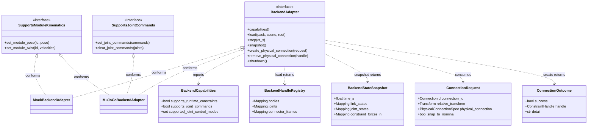
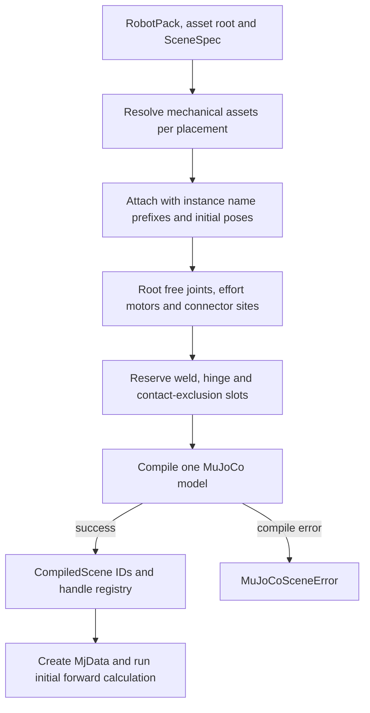
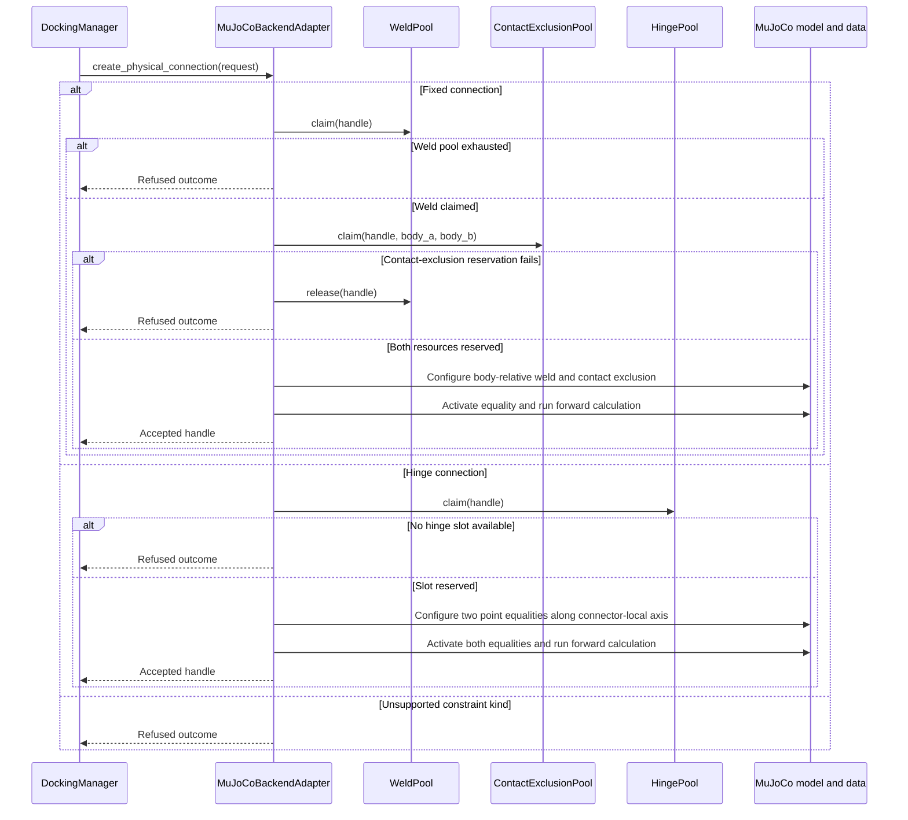

A backend turns a semantic scene into mechanical state and executes physical
constraint requests. ModSim retains the meaning of connectors, docking policy,
connections, and assemblies. This boundary lets the mock and MuJoCo adapters
exercise the same connection lifecycle while providing very different levels
of mechanical fidelity.

The implemented interface contract remains `docs/backends.md` in the
repository. This explanation follows `src/modsim_robotics/backends/` and
`src/modsim_robotics_backend_mujoco/`; it complements the
[runtime orchestration](runtime-model.mdx) and
[docking lifecycle](docking-lifecycle.md) pages.

## Keep engine objects behind an adapter

`BackendAdapter` in `backends/base.py` is a runtime-checkable protocol with seven
operations. `load()` receives a typed `RobotPack`, a `SceneSpec`, and optional
asset root; it returns a `BackendHandleRegistry`. `step()` advances the engine,
`snapshot()` reports observations, and `shutdown()` releases resources.
Connection creation and removal acknowledge whether the physical operation
actually succeeded. `capabilities()` declares supported features.

The UML below shows protocol conformance and exchanged data, not inheritance
from a common implementation base. Optional control protocols remain separate
from the minimum adapter contract.

Backend-native handles map stable ModSim identifiers onto engine objects.
They do not replace module, joint, or connector IDs in the semantic world.
Likewise, a snapshot contains the world-frame measurements needed by core
logic, rather than exposing an `MjModel`, renderer state, or a GUI object.

## Selection and capabilities keep optional dependencies optional

`backends/registry.py` stores `BackendEntry` records containing a name, summary,
lazy loader, and installation hint. `create_backend()` resolves an explicit
name first, then `MODSIM_BACKEND`, then the mock default. Unknown names and
unavailable dependencies produce different backend errors. Constructor options
are forwarded to the chosen factory, keeping engine-specific settings out of
`BackendAdapter`.

Importing the core package does not import MuJoCo or Studio. Checking whether
an optional backend is installed can invoke its loader, while normal named
registration remains lazy. A new engine can register its factory without
adding simulator imports to core modules.

Studio's **Runtime** workspace passes the **Backend** selection explicitly;
its initial MuJoCo choice does not change the registry's mock fallback.
Switching engines preserves scenario tuning and updates native-viewer
availability. Changing the demonstration or using **Reset demonstration
settings** loads preset defaults. The backend-independent launch helper checks
factory importability without constructing an adapter. Asset compilation and
physical feature support are still checked when the runtime actually loads
and executes the selected backend.

Capabilities affect behavior: docking refuses before creation when runtime
constraints are unsupported; joint-command validation checks advertised modes
and the optional `SupportsJointCommands` protocol. A schema declaration is
therefore not a guarantee that every adapter can execute it. Other capability
flags let clients discover facilities such as a viewer or pose writing.

## The mock isolates semantic behavior

`MockBackendAdapter` in `backends/mock.py` creates one kinematic body per module
and reports that pose for every semantic link. It does not read URDF geometry,
simulate contacts or gravity, or articulate internal joints. Within a welded
group, stepping propagates the representative module's rigid motion to the
other members.

This is useful for testing connector decisions and assembly changes without
engine dependencies. `fail_next_connection()` and `set_constraint_force()` let
tests exercise refusal and overload paths deliberately. Reported mock forces
are injected values, not a mechanical force solution.

The mock explicitly refuses hinges instead of pretending a rigid weld has a
rotational degree of freedom. Its successful fixed-style welds establish
connection-lifecycle semantics; they are not a substitute for a dynamics test.
Use MuJoCo for articulated motion and contact-dependent scenarios.

## MuJoCo compiles a whole scene once

`MuJoCoBackendAdapter.load()` calls `build_scene()` in
`modsim_robotics_backend_mujoco/scene.py`. It requires a pack directory because
it reads mechanical assets. Each placement imports an asset under an instance
prefix, gets a root free joint, and receives connector sites at authored poses.
Declared effort-controlled joints get bounded unit-gear motors. The composed
spec also reserves inactive runtime constraints before compilation.

This flow diagram is a conceptual grouping of `build_scene()` stages. It shows
data preparation and compilation, rather than a second runtime state machine.

A root free joint makes a module movable rather than rigidly fixed to the
world. The optional ground is a scene setting; module placement must account
for its height. `step(dt_s)` uses whole compiled solver steps, so a positive
request is rounded to a number of engine steps rather than changing the
integrator timestep. `snapshot().time_s` is the actual time reached.

Snapshots measure link poses and world-frame twists, joint state, connector
site frames, and active constraint-force magnitudes. The core then resolves
connector velocities and makes semantic decisions from those measurements.

## Runtime docking claims precompiled resources

MuJoCo model topology is fixed after compilation. A runtime connection claims
an existing inactive slot, configures it, and activates it. Weld and hinge pools
are separate; automatic capacities are at least eight slots each, while
explicit pool settings may choose another capacity.
The slot registries are implemented in `welds.py` and `hinges.py`; their capacity
and claim/release operations are independent of connector compatibility policy.

A fixed connection claims one weld and one contact-exclusion slot. The exclusion
suppresses contact for the exact constrained body pair, alongside authored
static exclusions; it does not disable collision throughout two articulated
modules or their assemblies. `welds.body_relative_transform()` converts the
connector-frame relationship into the body-relative relationship MuJoCo needs.

A hinge slot contains two `mjEQ_CONNECT` point equalities. Their anchors lie on
the line described by the connector-local hinge axis and authored separation.
Together they leave rotation about that line while constraining the other
relative degrees of freedom. Hinges retain collision and consume no weld
contact-exclusion slot. They are physical hinges, not a special visualization
of a fixed connection.

Release deactivates the corresponding equality or pair, returns pool resources,
and runs a forward calculation. Unexpected setup exceptions release claimed
slots before propagating; this resource cleanup is not a promise that every
other engine-side effect is transactionally reversible. Pool exhaustion or a
normal unsupported request returns a refusal, which core records as a failed
dock without adding a logical edge.

## Forces, controls, and present limits

A weld's reported scalar force is the norm of its translational equality-force
rows. A hinge reports the norm of the vector sum of its two point forces.
Moments are not folded into a quantity expressed in newtons. These readings
support the core overload path; they are not a complete connector wrench.

`SupportsModuleKinematics` permits explicit root pose/twist control for setup
and authored scenarios. This differs from robot actuator commands.
`SupportsJointCommands` uses stable semantic joint IDs and declared control
modes. Current MuJoCo execution supports **effort**; commands persist until
replaced or cleared. Position and velocity control remain schema vocabulary,
not implemented controllers. See [planning and scenarios](planning-and-scenarios.md)
for the distinction between authored motion and physically driven behavior.

MuJoCo does not execute compliant, ball, or custom runtime constraints. The
mock's fixed-style connection path is not an implementation of compliant
dynamics; ball and custom requests are rejected by the core guards.
Full backend mapping resolution remains incomplete: authored link and joint
names must match the chosen asset, and a connector specified only by a named
`frame` is refused by the current MuJoCo path. Numeric `local_pose` is the
supported connector placement route. A simulation-profile validation pass does
not remove these implementation limits.

For a new adapter, implement the protocol, report capabilities honestly, map
stable IDs to native handles, and exercise the shared lifecycle in
`tests/test_backend_conformance.py`. Keep simulator-specific imports and model
objects in the adapter package. The [Studio/Inspector explanation](studio-and-inspector.md)
shows how native rendering consumes this runtime without creating a second
physics owner; the [Python API reference](../reference/python-api.mdx) documents
the shared protocol and data types.
