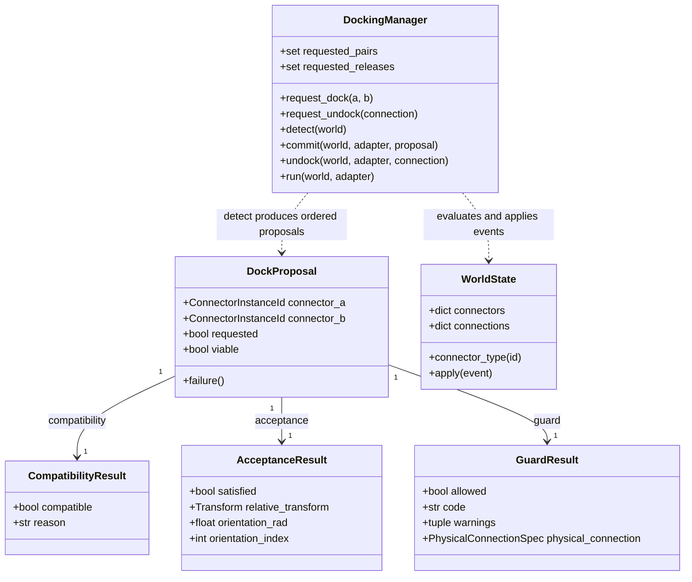
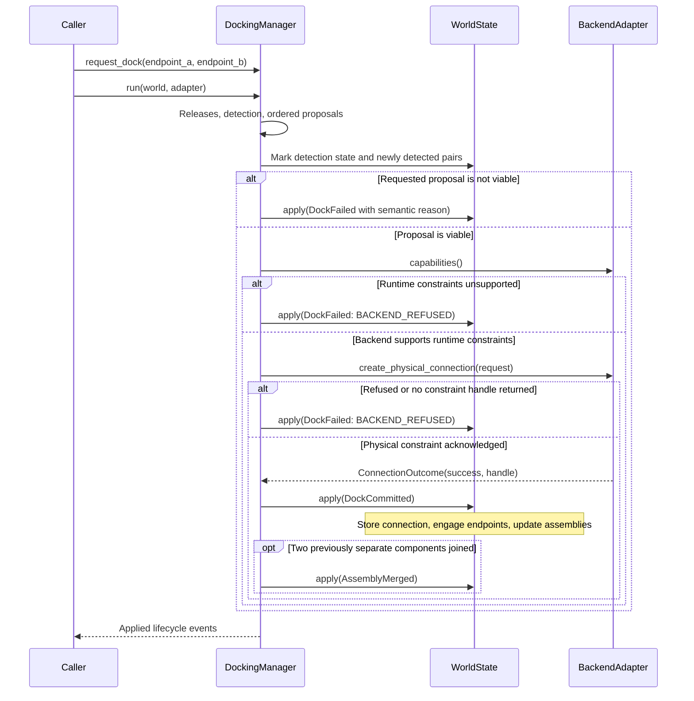
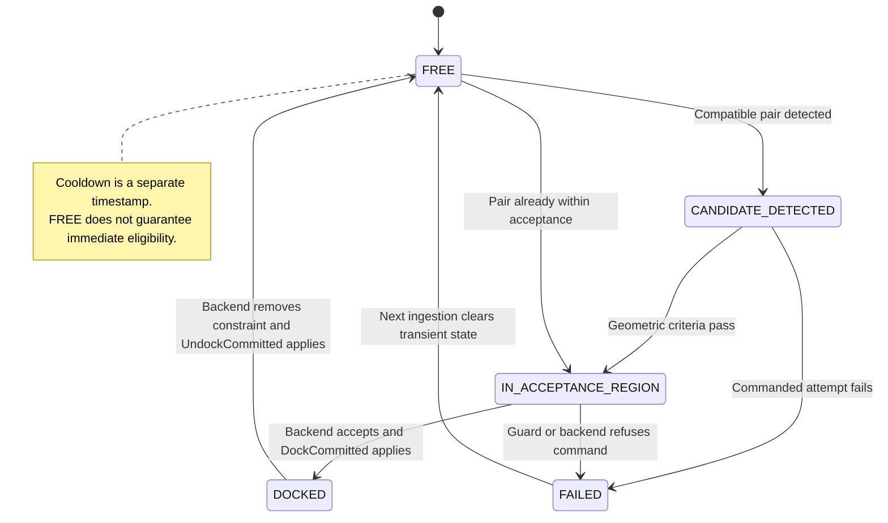

Docking is a semantic decision followed by a physical constraint operation.
Two connector frames can be close without being compatible, an admissible pair
can still require an explicit command, and a backend can refuse a physically
unsupported connection. ModSim keeps these decisions separate so a successful
logical edge always has an acknowledged backend constraint.

The implemented contract is `docs/docking_semantics.md`. The coordinating code
is `src/modsim_robotics/connectors/docking.py`; the surrounding step order is
explained in [runtime state and orchestration](runtime-model.mdx).

## Requests, proposals, and commitments are different objects

`DockingManager` holds requested connector pairs and connection releases.
`request_dock()` canonicalizes the endpoint order before adding a pair to its
set. `detect()` combines these explicit requests with nearby resolved,
unengaged connectors found by `candidate_pairs()` in `connectors/broadphase.py`.
The spatial-hash radius comes from the largest declared positional acceptance
tolerance. Requested pairs are evaluated even when they are outside that
neighborhood.

A `DockProposal` contains independent `CompatibilityResult`,
`AcceptanceResult`, and `GuardResult` values. Its `viable` property requires all
three to pass. It is an evaluation result, not a connection, and observing one
through `RuntimeSession.proposals()` does not commit anything.

This UML shows the proposal's actual result fields and the manager's
operations. The dependency on a world supplies measurements and catalogs;
a proposal does not own a world or a backend.

An unknown endpoint cannot be resolved into a proposal in the current
`_evaluate()` path. Queueing therefore is not an ID-validation or success
acknowledgment API. Use known runtime connector IDs and inspect the events
returned by processing the request.

## Three tests explain why a pair can latch

**Compatibility** is the reusable type-level relation implemented by
`evaluate_compatibility()` in `connectors/compatibility.py`. Both types must
name the other in `compatible_with`; gender rules must also agree. A one-sided
compatibility declaration is insufficient.

**Acceptance** is the measured geometry and velocity calculation in
`connectors/acceptance.py`. It evaluates origin separation, antiparallel docking
axes, roll against the allowed orientations, and relative connector-point
velocity. Both endpoints' acceptance shapes must pass. When tolerances differ,
the stricter positional, orientation, and velocity bounds govern. The result
retains measured criteria and the matched discrete orientation index, so a
rejection can be explained and a committed orientation can be preserved.

**Guards** in `connectors/guards.py` answer whether a geometrically suitable
pair may connect. They reject self-pairing, two endpoints on the same module,
engaged connectors, active cooldown, incompatible physical-connection intent,
unsupported constraint kinds, and passive capture when an explicit command is
required. Fixed and hinge declarations are different intents; hinge endpoints
must agree on their connector-local axis and anchor separation.

`resolve_physical_connection()` can use the declaration from one endpoint when
the other omits it. If both declare a connection, their kinds must agree; two
hinge declarations must also agree on their complete hinge geometry. Semantic
acceptance of an intent still leaves the adapter's support check to perform.

These layers have different jobs. The auto-latch policy controls whether
passive capture is permitted; it does not move modules or implement a latch
actuator. Acceptance evaluates measured state. A
simulation can therefore show a nearby pair yet legitimately retain two
separate assemblies.

## A docking pass has deterministic ordering

`DockingManager.run()` first processes requested releases in sorted order. It
then detects proposals, marks detection states, and attempts commits in sorted
pair order. A set of endpoints used by successful commits prevents the same
connector from committing twice in that pass.

`_mark_detections()` emits `DockCandidateDetected` when a compatible pair newly
enters the manager's detected set, rather than appending one event every frame.
Non-viable opportunistic proposals do not produce failure spam. A requested
proposal consumes its command when `commit()` evaluates the attempt, so one
failed command does not automatically retry every simulation step.

A viable proposal creates a `ConnectionRequest` containing endpoint IDs,
parent links, connector-local frames, the requested relative transform, physical
constraint specification, and orientation metadata. The backend capability gate
must allow runtime constraints before the adapter is asked to create one.

This is the two-phase boundary: physical acknowledgment precedes logical
commit. It does not make every possible adapter exception a recoverable
transaction. Operational exceptions can propagate; the adapter is responsible
for cleaning up its own partially allocated resources. The concrete
[backend implementations](backends.md) explain those resources.

## Alignment is an explicit modeling choice

With measured alignment, the committed relative transform preserves the
observed mating geometry. With nominal alignment, the request describes exact
connector alignment at the matched orientation and asks the backend to snap to
it. Either connector type requesting nominal alignment is sufficient.

The core does not teleport a body while applying `DockCommitted`. The backend
performs any snapping, and the world sees updated measured poses on a subsequent
snapshot ingestion. This distinction matters when comparing lattice
reconfiguration demonstrations with physical approach-controller experiments.
A nominal snap can remove accumulated geometric drift, but it is not evidence
that a real controller achieved that alignment.

## Release, failure, and overload remain observable

The following diagram is a reduced view of states the ordinary pipeline
produces. It omits legal enum states that are not automatically traversed by
every docking attempt.

`DockFailed` sets available endpoints to `FAILED` and starts their configured
cooldown. Ingestion clears transient failure and detection states; it does not
remove the cooldown timestamp. `ALIGNING`, `LATCHING`, `LOAD_BEARING`, and
`RELEASING` exist in the model vocabulary, but the ordinary engine does not
provide a physical actuator/controller phase for each label.

For release, `undock()` checks the connection and both endpoint policies, calls
`remove_physical_connection()`, and applies `UndockCommitted` only after a true
removal acknowledgment. An unknown connection, unsupported undocking policy,
or backend refusal produces `UndockFailed` and leaves the logical connection
active. Successful removal recomputes only the affected assembly; an
`AssemblySplit` event is emitted only if it actually separates into components.
Loop-closing connections are allowed, so removing one edge need not split a
connected structure.

Overload processing in `RuntimeSession._evaluate_overloads()` compares reported
constraint force with the lowest declared endpoint break-force limit. It
records `ConnectorOverloaded` and invokes the same guarded release path. Read
the resulting release events to determine whether removal succeeded. Finally,
removing a constraint does not push bodies apart: separating motion belongs to
a controller or [scenario](planning-and-scenarios.md), not to undocking itself.

## Put extensions at the decision boundary they change

A new connector family can reuse the existing schema and lifecycle through
RobotPack data. A new acceptance shape belongs in `AcceptanceShape` and
`evaluate_acceptance()`, with corresponding validation and geometry tests.
Changes to permission or cooldown rules belong in the guard layer. A new
physical constraint kind also needs a request representation, adapter execution,
event/state preservation, and lifecycle tests; adding a catalog label alone
does not supply those mechanics. Keep these semantic decisions in core rather
than making each simulator invent its own definition of a successful dock.

Follow [runtime state](runtime-model.mdx) for event application and measured-state
ingestion, or the [Python API reference](../reference/python-api.mdx) for the
related event, connector, and request types.
