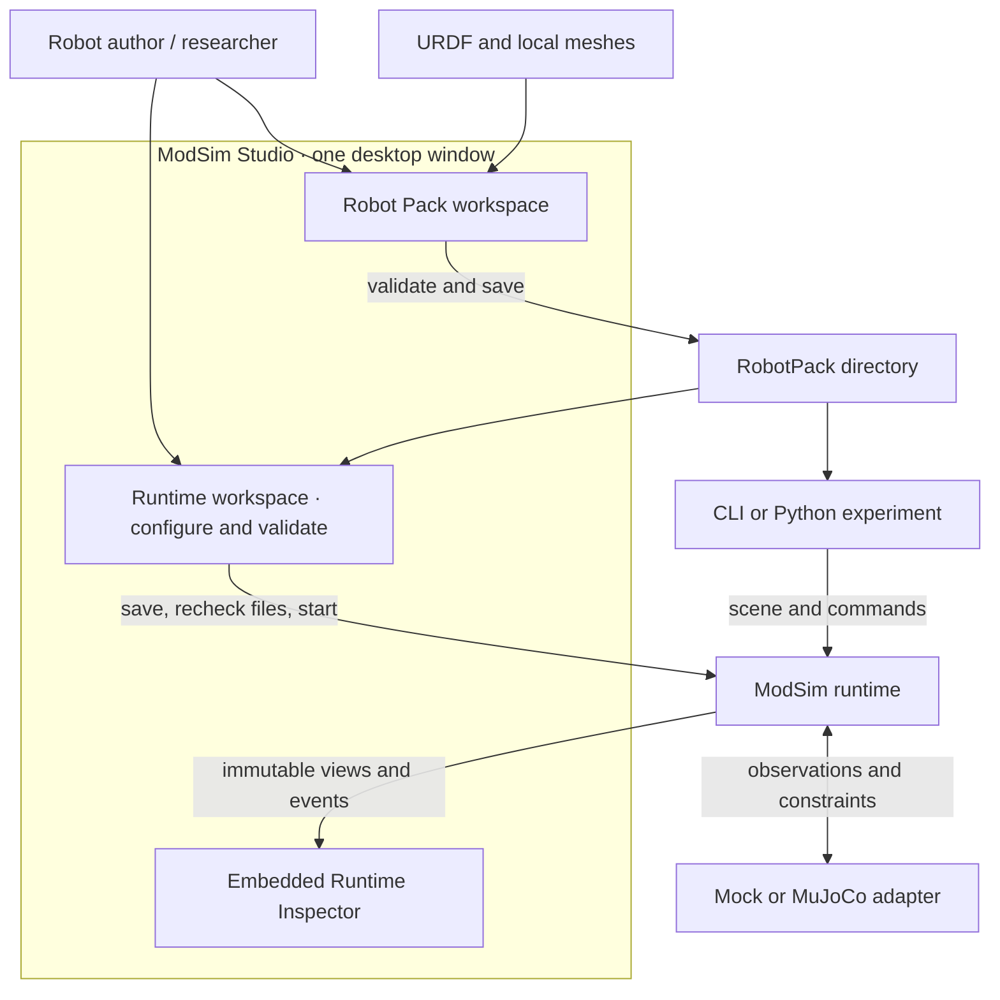
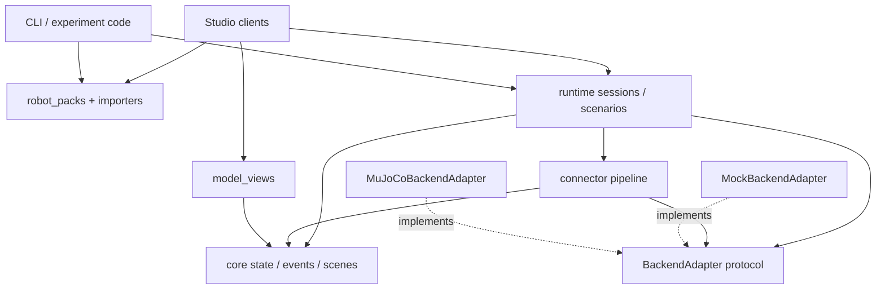

ModSim separates a modular robot's **mechanical description**, its **connection
semantics**, and the **execution of a particular experiment**. This separation
lets the same RobotPack drive an authoring application, a small deterministic
connector check, or a physical simulation without putting simulator objects
into the shared robot model.

This section explains the implemented architecture for contributors and
researchers who need to reason about the code. Start with this overview, then
follow the chapters in order. The [How-to guides](../how-to/index.md) show how
to use the applications; the [Python API reference](../reference/python-api.mdx)
provides individual declarations and docstrings.

## Reading path

The chapters move from durable input data to one running world, then explain
how clients, planners, and generated views use that world.

| Chapter | Question it answers |
| --- | --- |
| [Source map](codebase-map.md) | Where is every application module, and which subsystem owns a responsibility? |
| [RobotPack pipeline](robot-pack-pipeline.md) | How do URDF assets become typed pack data, editable documents, and safely persisted files? |
| [Units and orientation](units-and-orientation.md) | How do authoring, runtime, Inspector, and CLI units map onto canonical SI and quaternion poses? |
| [Runtime and state](runtime-model.mdx) | How do scenes become module instances, and how does a session maintain canonical state? |
| [Docking lifecycle](docking-lifecycle.md) | How does a candidate become a backend-confirmed connection or an explicit failure? |
| [Backend boundary](backends.md) | What must a simulator implement, and how do mock and MuJoCo differ? |
| [Studio and Inspector](studio-and-inspector.md) | Which window, thread, or process owns editing, simulation, and presentation? |
| [Planning and scenarios](planning-and-scenarios.md) | How are goals, generated actions, controllers, and physical execution separated? |
| [Model views](model-views.md) | How are topology and lattice representations derived and kept consistent with measured state? |

Each chapter combines class responsibilities, source locations, and runtime
interactions. Class diagrams show selected relationships needed to explain the
subsystem; they are not an attempt to draw every class in one graph. Sequence
diagrams describe actual call order. Flowcharts explain decisions and ownership
boundaries. Read the accompanying text for conditions and invariants that a
picture cannot express.

## System context

A user prepares a RobotPack once, then chooses how to consume it. Studio's
Robot Pack and Runtime workspaces share one native window while keeping
editable documents and live simulation state separate. The Runtime Inspector
can also launch on its own. The CLI and a Python experiment are other clients
of the same core. None requires a pack to contain executable Python plugins.

The RobotPack is input data, not a saved running scene. A module type describes
one reusable kind of module. A `SceneSpec` places instances of those types. A
`RuntimeSession` coordinates one running world and one backend. Saving a pack
does not save the current physical trajectory or turn Inspector node positions
into new mechanical geometry.

## The deployment units

The distribution is `modsim-robotics`. It contains three Python namespaces with
separate code and dependency responsibilities. The default installation includes
Studio and its GUI libraries; simulator backends are added through extras such
as `modsim-robotics[mujoco]`:

| Namespace | Responsibility | Dependency boundary |
| --- | --- | --- |
| `modsim_robotics` | Schema, import, validation, persistence, state, docking, runtime coordination, planners, and view generation. | No Qt, PyVista, PyQtGraph, or MuJoCo imports are required by the core. |
| `modsim_robotics_backend_mujoco` | MuJoCo scene compilation, observations, actuators, runtime constraints, and native viewer hosting. | Installed physics dependencies are needed when this backend is selected. |
| `modsim_robotics_studio` | Authoring document UI, Runtime setup and preflight, Inspector controllers, and desktop presentation. | Included in the default installation; a working display is needed for its windows. |

These are software packages within one distribution, not three network
services. The native-viewer execution path uses a child process on the same
machine; the semantic-only Inspector uses a worker thread. A command-line or
Python experiment can run without the Studio window or a model-view recipe.

`pyproject.toml` defines the console commands and optional extras. Backend
registration is lazy: choosing the mock backend does not import MuJoCo. The
source map documents the supporting website, tests, examples, and release tools
as well as these application packages.

## State ownership is the central design rule

Several objects describe a robot, but they answer different questions.

| Representation | Main types or source | What it owns |
| --- | --- | --- |
| Imported mechanics | `ImportedRobotAsset`, URDF and mesh files | Links, joints, geometry, materials, and source mechanical names. |
| Pack semantics | `RobotPack`, its manifest, hardware catalog, capabilities, and mappings | Module types, connector definitions, compatibility, acceptance, limits, and view recipes. |
| Editable document | `StudioProject` | A validated in-memory document, imported asset cache, filesystem context, and dirty status. |
| Initial scene | `SceneSpec`, `ModulePlacement` | Which concrete modules exist, their module types, and their initial poses. |
| Backend observations | `BackendStateSnapshot`, `BodyState`, `JointState` | Measured results from the selected backend at a sample time. |
| Canonical runtime | `WorldState`, runtime entities, `EventLog`, `AssemblyIndex` | Current measured module/connector state, committed connections, event history, and derived assembly membership. |
| Planning intent | `AssemblyPlan`, `LatticePlan`, planning snapshots | Desired structures, proposed actions, routes, and execution diagnostics. |
| Presentation views | Immutable model-view DTOs and `RuntimeInspectorFrame` | A projection of state for a consumer, with source stamps and event deltas. |

There are two important consequences. First, an event log is a record of
semantic lifecycle changes; measured poses and joint values also arrive through
`WorldState.ingest()`. Event replay alone does not recreate every physics sample.
Second, planned target edges and generated graph edges have different meanings.
A target expresses intent. A live edge represents an already committed
connection. Drawing either one cannot create a physical constraint.

## Component dependencies

The shared runtime depends on protocols and domain data. Concrete backends and
UI clients sit at its boundaries. The arrows below indicate dependencies or
consumption, not the direction of a physics force or an event.

The Builder's viewport can import simulator-independent URDF geometry without
starting a `RuntimeSession`. The Inspector can consume immutable frames without
owning the live world. A planner can reason over typed goals and observations
without depending on Qt. These are deliberate reuse boundaries rather than
separate copies of robot state.

## Follow one experiment from input to result

### 1. Resolve durable input

Explicit setup prepares the user's ModSim data home and the bundled starter.
`resolve_robot_pack()` turns a selected pack ID, version-qualified ID, or path
into a directory. Library configuration locates packs; it does not choose a
robot implicitly. `RobotPackLoader` reads the manifest and referenced YAML into
strict typed models and retains their root directory in `LoadedRobotPack`.

The import path is a separate authoring operation: `URDFImporter` reads local
mechanics and `DraftPackBuilder` creates a pack draft. Connectors and docking
rules must be authored because the mechanical file does not define them.

### 2. Create an execution owner

A desktop user switches from **Robot Pack** to **Runtime** and chooses the
backend, demonstration, module type, and model view. `RuntimeWorkspace` calls
the Qt-free helpers in `runtime_launch.py` to check this request, confirms any
save, reloads the files, and checks the saved input before starting its
embedded Inspector. F6/F7 remain generic authoring/structural metadata checks;
the launch preflight also checks backend availability, demonstration inputs,
and view generation. It does not run physics or guarantee successful asset
compilation.

A Python caller creates a `RuntimeSession` directly. The Inspector instead
uses `RuntimeInspectorRunner` to validate configuration, choose a named
scenario, resolve a model-view recipe, and create the session. The runner and
scenario execute in one owner thread or child process. GUI controls request
pause, resume, or stop; they do not step another copy of the simulation.

Core sessions and headless runs need no model view. The Inspector requires a
runtime-enabled recipe whose generated result it can render. Studio selects
the recipe explicitly and offers **Add topology view** as an ordinary unsaved
pack edit when a generic representation is missing.

### 3. Advance and commit

A session advances the backend, ingests its snapshot, handles overload releases,
and processes connector requests and candidates. The docking pipeline checks
compatibility, acceptance, and guards before asking the backend to establish a
constraint. Only backend acceptance permits the logical connection to commit.
Assembly changes and semantic events follow that commitment.

A scenario adds control and completion conditions around this loop. A scripted
kinematic demonstration can prescribe motion. A physical controller sends
bounded joint efforts and lets MuJoCo integrate motion. These execution models
are intentionally distinguished in the planning and backend chapters.

### 4. Project and present

`ModelViewFactory` builds a topology or lattice view from the current source
state. The runner combines a coherent view, metrics, event delta, and optional
planning diagnostics into an immutable Inspector frame. Presentation code can
coalesce geometry refreshes while retaining each ordered event. Its cameras,
selection, labels, and target overlays stay presentation state.

### 5. Finish and release resources

Completion, user stop, time-budget exhaustion, and failure are distinct
results. Interactive execution freezes a terminal result for inspection;
backend cleanup belongs to the runtime owner. Saving the authoring document
and stopping the simulation are separate operations with separate lifetimes.
Studio retains the result, then enables **Back to setup** after execution
resources have stopped. An open native MuJoCo companion can hold a finished
scene until **Stop** or viewer close. In-memory authoring edits can continue,
but saving/exporting or replacing the pack waits for that execution owner to
finish; those edits apply to a subsequent launch.

## Architectural decisions and their consequences

| Decision | Why it exists | Consequence when extending the system |
| --- | --- | --- |
| URDF is an imported mechanical asset; YAML adds modular semantics. | Mechanical tooling can remain reusable while connector rules stay explicit. | Do not infer physical docking policy from a link or mesh name. |
| Strict typed, self-contained packs. | Portable data and actionable validation are needed across clients and machines. | Keep paths relative and contained; preserve the pack's schema and persistence contracts. |
| Backend-neutral IDs and adapter protocols. | Engine handles are not portable semantic identities. | Translate handles inside the adapter; preserve core event and ID types. |
| Backend-confirmed connection commits. | A logical connection must correspond to an accepted physical operation. | Refuse unsupported constraints explicitly instead of fabricating success. |
| Measured state and planning intent are separate. | A desired pose or graph is not evidence that a physical action succeeded. | Verify observed topology and pose before reporting completion. |
| Immutable views and transport frames. | Renderers must not race or mutate a live simulation owner. | Send coherent projections with revisions, not a mutable `WorldState` reference. |
| Bounded scenario and search execution. | Unsupported layouts or failed physical captures need a terminal outcome. | Preserve cancellation, diagnostics, and explicit failure/time-limit handling. |

## Extension points and current limits

For a new robot description, use the [URDF authoring guides](../how-to/index.md).
For a new simulator, implement `BackendAdapter`, register it, declare truthful
capabilities, and run backend-conformance tests. For a new view, implement a
`ModelViewBuilder` and register it with `ModelViewFactory`; packs select its
stable builder ID and bounded JSON configuration. For a new scenario or planner,
keep the generated intent separate from the measured world and preserve the
single execution owner.

The source contains schema vocabulary beyond the adapters' executable feature
sets. Fixed constraints execute in mock and MuJoCo; hinges require MuJoCo.
Compliant, ball, and custom connection vocabulary does not imply an implemented
physical adapter. Scalar effort commands are the current MuJoCo joint-command
surface; position and velocity control declarations are not interchangeable
with implemented motor controllers. Isaac-related asset fields do not mean an
Isaac backend ships today. Capability declarations are descriptive data, not a
capability-execution engine.

Likewise, a structurally valid pack has not passed a physics experiment, and a
geometrically generated plan is not a dynamics guarantee. Each detailed chapter
states the implementation boundaries relevant to its subsystem. The
[source map](codebase-map.md) provides the complete file inventory and points
to the appropriate chapter when you start reading a particular module.
