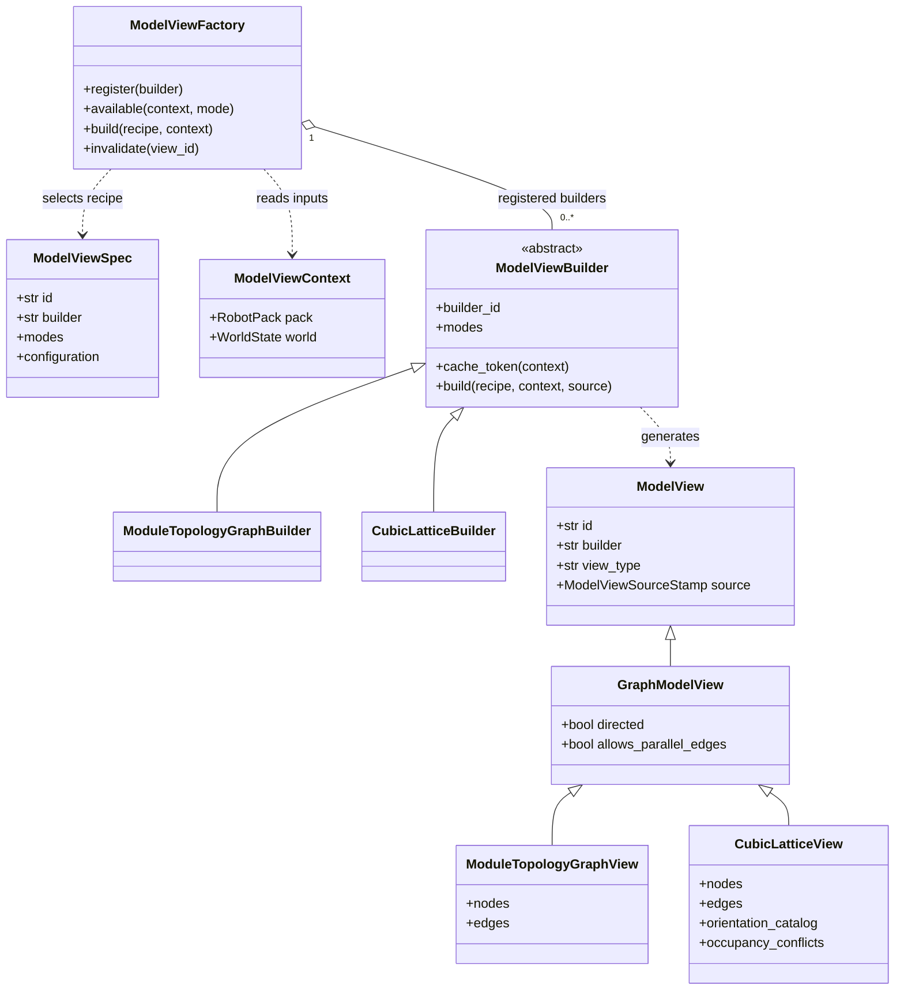
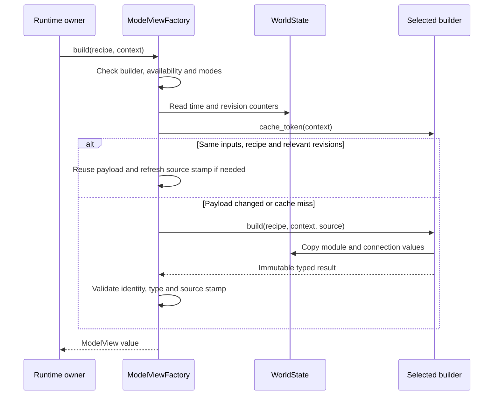
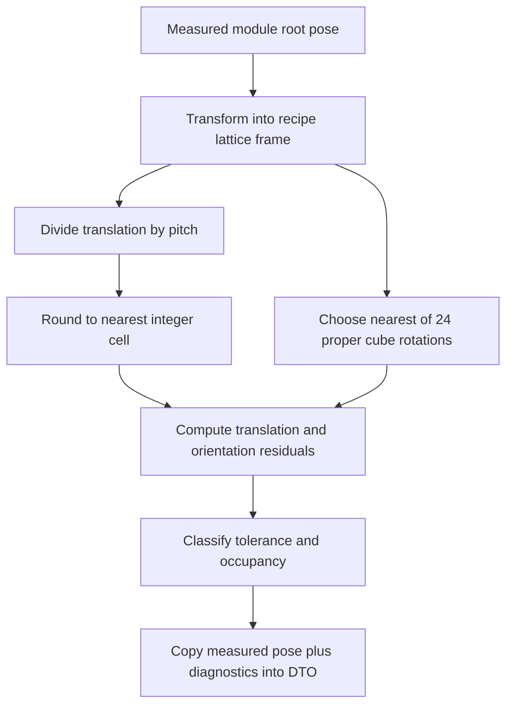

A model view gives a client a useful representation of canonical runtime
state. A topology algorithm may need modules and connections; a lattice
inspector needs measured poses, nearby integer cells, and alignment residuals.
Both read the same `WorldState`. Generating either representation leaves that
world and the saved RobotPack unchanged.

The [architecture overview](index.md) places this subsystem between runtime
state and its consumers. The [runtime state model](runtime-model.mdx) explains
the source objects. This page follows a recipe through builder selection,
generation, caching, and immutable transport.

## Recipes, builders, and results

Three identifiers have separate jobs. A recipe's `id` names one view within a
pack, its `builder` names registered Python behavior, and the result's
`view_type` identifies a representation a consumer can understand. For example,
a pack can name its recipe `module_topology`, select the
`module_topology_graph` builder, and receive a `module_topology_graph` result.

`ModelViewSpec` in `robot_packs/schema.py` stores the recipe's name, modes,
default flag, and bounded JSON configuration. It contains no Python import path
or executable plugin. Applications register trusted builder implementations
through `ModelViewFactory.register()`. An unknown builder can remain valid pack
data even when the current application cannot generate that view.

Recipes remain optional for the pack format and core runtime. A headless
experiment can create and step `RuntimeSession`, process docking, and collect
events without generating any view. The Inspector adds a consumer requirement:
it must resolve a runtime-enabled recipe and render that recipe's result.

In Studio's **Runtime** workspace, **Model view** supplies an explicit recipe
selection; `default: true` is unnecessary for that selected recipe. If no
suitable recipe exists, **Add topology view** adds a uniquely named generic
recipe to the editable project. Saving the pack persists it. The standalone
Inspector uses a runtime default when no `--model-view` override is supplied.

F6/F7 validate pack structure and metadata rather than local builder or
renderer availability. **Validate runtime** checks the selected launch and
constructs its view against a small canonical sample world. This exercises
builder registration, modes, configuration, and supported result type without
creating a physics engine. A successful report is not proof of simulator
asset compilation or of a demonstration reaching its goal. See the
[Studio launch architecture](studio-and-inspector.md) and
[run workflow](../how-to/run-robot-pack.md) for the full handoff.

`GraphModelView` gives graph results their shared semantics and typed node/edge
collections. `ModelViewContext` is a frozen input wrapper holding a pack and an optional
world. It rejects a world created from a different pack. It does not freeze
the world itself: the runtime owner must call generation while its state is
coherent.

| Source within `src/modsim_robotics/model_views/` | Responsibility |
| --- | --- |
| `base.py` | Builder contract, context, immutable descriptor, and typed failures. |
| `factory.py` | Registration, availability checks, recipe selection, result validation, and bounded caching. |
| `models.py` | Strict immutable envelopes, graph nodes and edges, lattice classifications, and source stamps. |
| `topology.py` | `ModuleTopologyGraphBuilder` and canonical connection-to-edge conversion. |
| `lattice.py` | `CubicLatticeBuilder`, strict configuration, 24 cube rotations, quantization, and residuals. |
| `__init__.py` | Public package exports consumed by runtime and clients. |

## Build and cache lifecycle

Each factory owns its registry and cache. A default factory registers both
built-in builders; `include_builtins=False` creates an empty registry for a
specialized application. Registration checks a stable lowercase identifier and
the builder descriptor, then rejects duplicate IDs. `descriptors()` gives a
deterministically ordered catalog, while `available()` filters by supplied
inputs and requested mode.

`build()` resolves the builder, checks required inputs and recipe modes, and
constructs a source stamp. A stamp records pack identity, simulation time, and
independent sample, topology, docking, and event revisions. The builder chooses
the subset relevant to its payload through `cache_token()`. Both current
builders observe backend samples and committed topology because their nodes
carry poses and their edges reflect connections.

The cache slot contains pack identity, world identity, and recipe ID. The entry
also retains those objects, the full serialized recipe fingerprint, and the
builder's revision token. Changing configuration therefore invalidates a view
even if its recipe ID stays the same. Strong references prevent object-ID reuse
from accidentally matching an unrelated world.

The default capacity is 32 slots, with least-recently-used eviction. Each slot
keeps its latest result, so advancing a long simulation does not retain every
historical snapshot. `invalidate()` clears all slots or those for one recipe.
Unchanged relevant revisions reuse the payload; if only other source counters
changed, the factory copies the envelope with an updated source stamp.
Completely unchanged source can return the same immutable result object.

An internal lock protects registry and cache bookkeeping. It does not turn a
mutable world into a concurrently readable snapshot: builder work happens
outside that lock, and generation belongs on the same owner that steps the
session. A GUI receives the generated value afterward.

## Topology preserves connection semantics

`ModuleTopologyGraphBuilder` emits one `ModuleGraphNode` for every module,
including disconnected ones. Nodes copy stable IDs, module type, assembly,
world position, and quaternion. Each active `ConnectionRuntime` becomes one
`DockedConnectionEdge`, with canonical endpoint order, connector IDs,
constraint type, mating orientation, and creation time.

The result is an undirected multigraph. Two separate connector bonds between
the same modules remain two edges. A hinge and a fixed bond remain
distinguishable through the copied constraint type. Candidates, failed docks,
and planner targets do not create edges: topology changes when the runtime
commits or releases a connection through the
[docking lifecycle](docking-lifecycle.md).

Sorting nodes and connections by stable identifier makes output deterministic.
The builder accepts no configuration fields; a misspelled or unexpected field
fails generation rather than being ignored. Graph layout is absent from this
DTO. Studio assigns stable logical positions in its presenter, allowing the
graph to remain readable while the physical modules move.

## Cubic-lattice classification

`CubicLatticeBuilder` retains the same module/connection semantics while adding
a spatial classification. The recipe supplies a positive pitch, position
tolerance smaller than half a cell, orientation tolerance no greater than
π/4, and optionally a world-frame origin and unit quaternion. Unknown fields,
non-finite values, or inconsistent tolerances raise `ModelViewBuildError`.

Exact half-cell translation ties round away from zero. Orientation selection
uses the 24 proper axis-aligned rotations of a cube, with stable indices and
descriptive IDs. The DTO includes that complete catalog so a renderer does not
need a second orientation convention. A `CubicLatticePoseResidual` records
translation in lattice axes and the angular distance to the chosen rotation.

`off_lattice` is true when either position or orientation falls outside its
tolerance. Occupancy conflicts group modules that are **position-valid** in the
same cell. A module with valid position but invalid orientation can therefore
participate in a conflict; a distant module merely rounded to that cell cannot.
Each connection endpoint is labeled by the nearest lattice-facing direction of
its measured docking axis, retaining the angular residual of that label.

Quantization is diagnostic. The builder writes no root pose, snaps no body,
creates no connection, and changes no pack recipe. Studio can render measured
cubes beside dashed snap cells precisely because both quantities remain in
the result. Its orbit camera, selected Z layer, labels, and overlay visibility
remain client presentation state.

## Transport, extension, and failure boundaries

`ModelViewDTO` uses strict frozen Pydantic models, finite scalar values, and
tuple-based collections. Results contain no Qt widget, simulator handle,
NumPy array, or mutable entity. `build_runtime_inspector_frame()` accepts the
two supported graph types and combines one with metrics, event deltas, and
optional planner intent. Planner snapshots must share the same source sample.
The [Studio architecture](studio-and-inspector.md) explains their thread and
process transport.

Failures identify the boundary: duplicate registration, unknown builder,
missing world input, unsupported mode, invalid configuration, or mismatched
result identity/type/source. A valid custom builder can still be unsupported
by the Inspector renderer; factory extensibility and GUI renderer availability
are separate capabilities.

To add a representation, implement `ModelViewBuilder`, choose a stable ID,
declare modes and inputs, define a revision token covering every value read,
and return an immutable typed result carrying the supplied source stamp.
Register it on each relevant client factory and add an authored recipe.
If Studio should display it, add the corresponding renderer and transport
support. Third-party discovery, matrix/frame/port views, and incremental graph
patch transport are future extensions rather than current built-ins.

Use the [Python API reference](../reference/python-api.mdx) for the published
runtime types and the [planning page](planning-and-scenarios.md) to understand
why generated targets and routes stay separate from measured model views.
