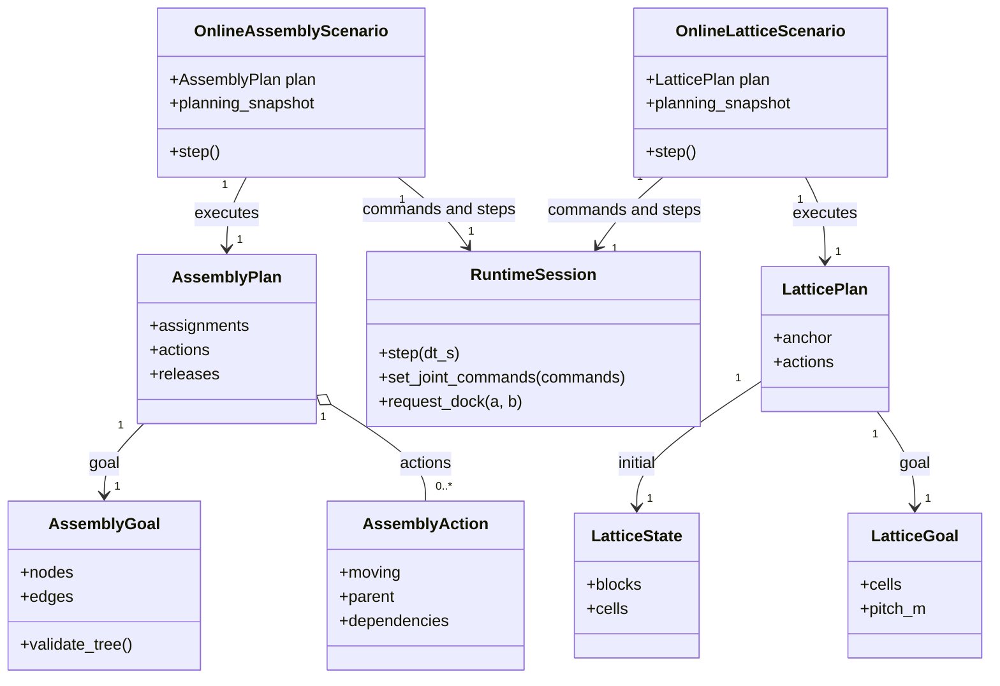
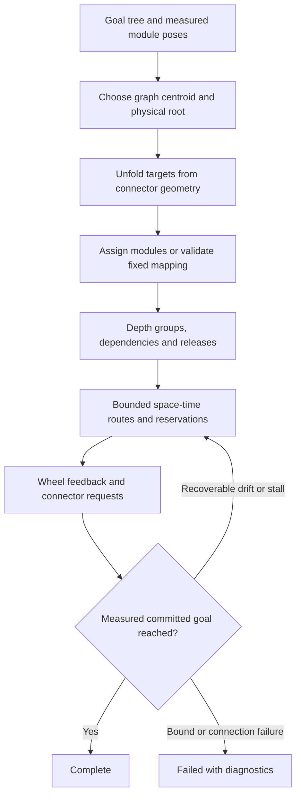
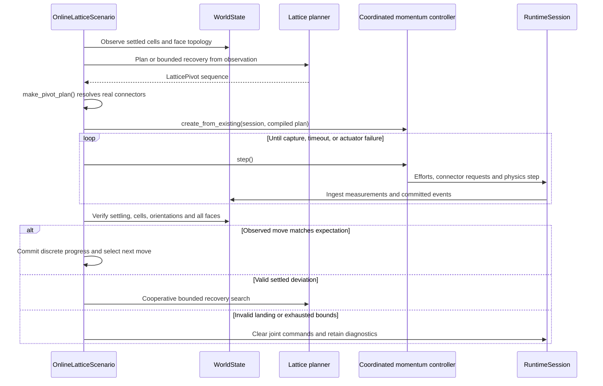

ModSim separates a requested configuration, a plan for reaching it, the
controller that attempts each action, and the measured result. This separation
lets the same connector lifecycle support a deterministic visual example,
wheel-driven assembly, or a momentum-driven cube pivot without treating a
planned edge as an existing physical connection.

The [architecture overview](index.md) shows the full dependency direction.
`modsim_robotics.planning` contains simulator-independent inputs, algorithms,
and immutable observations. `modsim_robotics.runtime` owns execution against
`RuntimeSession`. Simulator adapters integrate mechanics, and Studio displays
the resulting state and planner intent through separate payloads.

## A common scenario boundary

The Inspector's `RuntimeScenario` protocol requires `status` and `step()`.
A step advances a configured scenario and returns canonical events.
`RuntimePlanningScenario` adds `planning_snapshot` for scenarios exposing
generated intent. `RuntimeInspectorRunner` selects an implementation from
`RuntimeDemo`, constructs its scene and session, and publishes its status.
Controllers and planners therefore share the same execution host without
requiring Qt or a viewer in their implementation.

Two plan families serve different geometries:

The arrows represent held plan/session references. The plans contain immutable
values; mutable execution progress belongs to the scenario. A RobotPack defines
what connectors and joints mean. Goals and plans are scenario inputs rather
than new fields silently added to that format.

## Scripted and physical execution families

The runtime has several reference executors. Their names describe which layer
supplies motion, not interchangeable levels of physical fidelity:

| Runtime source and principal types | Execution responsibility |
| --- | --- |
| `reconfiguration.py`: `ReconfigurationPlan`, `ReconfigurationAction`, `ScriptedReconfigurationScenario` | Stage an authored initial topology and execute ordered connection replacements with controlled approach/release motion. Includes the two-cube `dock` and `dock_undock` demos and the scripted SMORES reference. |
| `physics_docking.py`: `DifferentialDriveDockingScenario` | Drive a two-module SMORES approach, dock, hold, release, and retract using joint efforts and measured feedback. |
| `physical_reconfiguration.py`: `DifferentialDriveReconfigurationScenario`, `PhysicalDockController`, `PhysicalActionRoute` | Execute an authored SMORES route using wheel control, articulated-joint holding, and target-relative waypoints. |
| `differential_drive.py`: `DifferentialDriveGeometry`, `VelocityEffortController`, `PositionEffortController` | Convert desired planar motion and joint feedback into bounded efforts; report assembly wheel-allocation lateral residuals. |
| `kinematic_pivot.py`: `KinematicPivotScenario`, `KinematicPivotRoute` | Move a detached assembly along an authored rigid arc and commit its landing connection through the normal lifecycle. |
| `momentum_pivot.py`: `MomentumPivotScenario`, `MomentumPivotConfig`, `MomentumPivotTelemetry` | Execute one physical face-to-hinge-to-face pivot through flywheel spin-up, braking, measured rotation, and capture. |
| `momentum_sequence.py`: `MomentumPivotSequencePlan`, `MomentumPivotSequenceScenario` | Compose authored single-cube physical pivots without taking over rigid-body motion. |
| `coordinated_pivot.py`: `CoordinatedPivotPlan`, `CoordinatedKinematicPivotScenario`, `CoordinatedMomentumPivotScenario` | Release/capture every required face of a moving slab; support cyclic face topology and several acting flywheels. |
| `online_planning.py`: `OnlineAssemblyScenario` | Schedule generated SMORES actions, plan routes, merge commands, and recover from bounded navigation/capture failures. |
| `mblocks_lattice.py`, `mblocks_online_planning.py`: `OnlineLatticeScenario` and lattice observation/compilation functions | Translate between measured cubes, discrete moves, physical controllers, and settled-state verification. |

Kinematic executors may write root poses along prescribed paths. Their purpose
is a deterministic geometric and semantic reference. Physical wheel and
momentum executors limit root staging to initialization, then use joint efforts
and ordinary connector requests. MuJoCo supplies contact, gravity, inertia,
reaction torque, and constraints. Running a kinematic executor on MuJoCo does
not turn its prescribed motion into an actuator-driven controller.

`demo_configs/` contains shipped Python presets for SMORES Driver-to-Snake,
two-module docking, M-Blocks five-module pivots, twelve-module lines, and
mat-to-staircase transformations. `examples/scenarios/` provides executable
entry scripts. Robot assets remain external RobotPacks. In particular, the
staircase preset feeds the same coordinated topology/route to its kinematic
and physical executors; it is an authored demonstration, not an online planner.

`RuntimeDemo` currently exposes 16 names. The five SMORES-specific names select
wheel docking, scripted/physical Driver-to-Snake, online assembly, or online
Driver-to-Snake. M-Blocks names select five-module kinematic pivots, a momentum
pivot, kinematic/physical twelve-module line and staircase references, or
small/large/elbow online lattice runs. The two remaining names are the generic
two-cube docking examples. `demos.py` is the authoritative name list;
`inspector_runner.py` resolves presets and validates their backend, timestep,
ground, gravity, and connector requirements.

## SMORES assignment, routes, and feedback

`planning/models.py` defines `AssemblyGoal`, `AssemblyPlan`, `Assignment`,
`AssemblyAction`, and `PlanningSnapshot`. Goals require a connected tree,
unique connector use, and supported planar mating orientations.
`planning/assembly.py` implements the following decomposition:

`tree_root()` uses a tree centroid based on branch counts. Without a supplied
mapping, the physical root is nearest the average XY module location, and
`minimum_assignment()` uses deterministic Hungarian assignment to minimize
straight-line distance. It does not optimize obstacle-aware travel time.
`plan_assembly()` unfolds target poses and orders depth groups; explicit
fixed mappings support reconfiguration while preserving already-correct bonds.
General initial-to-goal graph correspondence search is outside this baseline.

`planning/routing.py` performs bounded space-time search over translation,
rolling turns, pivots, and waits. `Footprint`, `Obstacle`, and `Reservation`
represent oriented rectangles and predicted assembly occupancy.
`swept_clear()` checks intermediate motion, not just endpoints. Search defaults
bound expansions and time slots; failure means no route was found within those
bounds, rather than proving that no route exists.

`OnlineAssemblyScenario` keeps assignment fixed during route recovery.
Its `_schedule()` checks dependencies and reservations at a planning cadence;
`_advance()` tracks motion and capture; `_submit_commands()` merges active
control with holding/braking commands. The scenario then calls the session's
physics step once. Planner search runs synchronously in that owner, so physics
does not race an observation during a search, although costly searches can
slow wall-clock playback.

Receiving targets are recomputed from measured connector frames. Tracking or
alignment stalls can trigger wheel-driven retreat and replanning. Recovery
attempts and action times are finite. Losing a preserved or completed bond,
refusing a required release, or finishing with the wrong committed topology
produces failure. The final mating corridor treats the intended receiving
module differently from other obstacles so legitimate close-packed docking
can occur; footprint and dynamics approximations still limit route guarantees.

## M-Blocks geometric planning and measured execution

`planning/mblocks/models.py` describes a connected planar lattice of 2–32
cubes, an unlabelled shape goal in an assembly-relative frame, and identity-
preserving quarter/half-turn actions. `geometry.py` checks admissibility,
stationary-remainder connectivity, boundary order, and swept-cell clearance.
`planner.py` constructs a common line, including its P3 removal queue, and
reverses the target's line construction to generate shape-to-shape moves.
`LatticePlanningError` reports unsupported geometry or exhausted bounds.

The geometric result is a proposed discrete route. `OnlineLatticeScenario`
must observe and execute each move before advancing that route:

`mblocks_lattice.observe_lattice()` measures the assembly-relative frame from
the anchor. `make_pivot_plan()` compiles geometric action identities into actual
face/hinge connector pairs. The coordinated momentum controller releases
incident faces, uses a transient hinge and bounded flywheel efforts, and
captures landing faces through normal acceptance checks. Other committed
faces must remain correct. There is no root pose, twist, or wrench correction
after initialization in this physical path.

After capture, the scenario waits for settling and verifies observed cells,
orientation, and exact face adjacency. A valid deviation may invoke cooperative
BFS recovery, yielding every 20 expansions, with a 4,000-expansion bound and at
most three replans. Physics and cancellation can proceed between batches.
Off-lattice observation, missing captures, topology mismatch, speed ceilings,
or timeouts terminate explicitly. The physical integration currently requires
the supplied 50 mm pack and one actuation plane; its settling feedback is a
simulation control extension, not a hardware-calibrated magnetic model.
The anchor defines observation coordinates while remaining physically movable.
Arbitrary 3D goals, prescribed final ID-to-cell assignments, simultaneous group
moves, and general orientation-constrained shape goals are outside this online
planar implementation.

## Results, limits, and extension points

The focused physical tests exercise four-block and six-block line-forming
presets, requiring 8 and 21 generated pivots respectively. They verify measured
goal cells, final face topology without a transient hinge, bounded effort, and
the absence of runtime root control. The elbow reversal and broader clusters
remain experimental: geometric plans can exist while physical capture or
actuator limits prevent completion. The connected SMORES online
Driver-to-Snake case also remains a debugging route; train tracking and crowded
approaches can exhaust recovery bounds. A successful geometric search alone
does not establish physical completion.

`PlanningSnapshot` and `LatticePlanningSnapshot` carry decisions, action
histories, plan revisions, and measured diagnostics. They remain separate from
canonical events and generated live edges. Inspector frames require matching
sample/time/topology stamps, and the current transport protocol is version 3.
See [model views](model-views.md) and
[Studio and Inspector](studio-and-inspector.md) for display ownership.

Add a planner by defining immutable goals/results, keeping geometric search
independent of adapters, and implementing an executor that owns session
commands and stepping. Validate a requested action through the existing
[docking lifecycle](docking-lifecycle.md), report bounded failures, and test
measured success conditions. Add presets and runner validation deliberately;
a new enum name alone does not supply execution behavior. The remaining
runtime modules provide sessions, metrics, pacing, inspection frames, protocol,
and host selection rather than additional planning algorithms. Continue with
[backend boundaries](backends.md) or the [Python API](../reference/python-api.mdx)
when tracing how an action reaches simulator mechanics.
