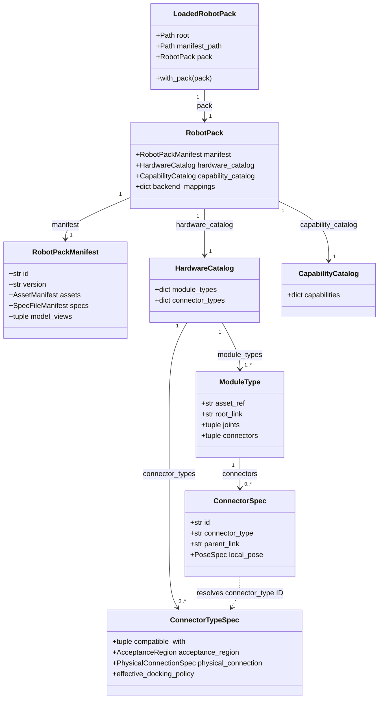
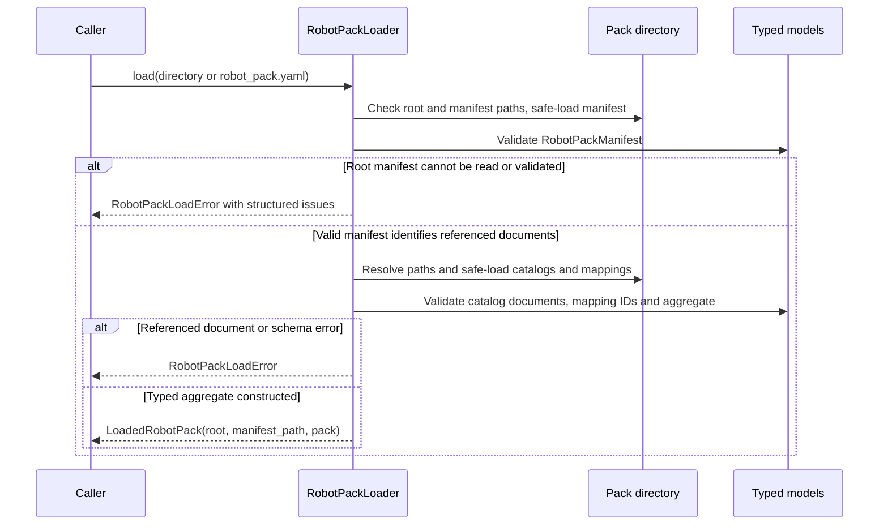
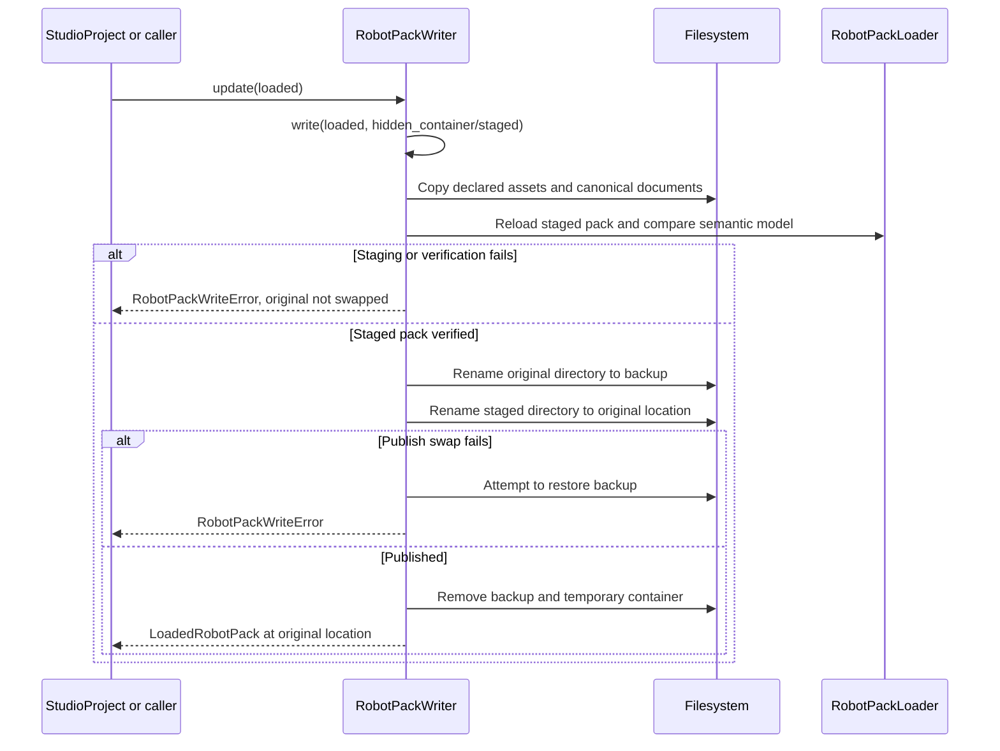

A RobotPack is the portable description of a robotic system. It combines
mechanical assets with modular-robot semantics, without choosing a running
scene, a simulator process, or a Studio window. This separation lets the same
pack support visual authoring, deterministic semantic tests, and physical
simulation.

The format and persistence contract is `docs/robot_pack_spec.md` in the
repository. This page explains how the implementation carries that contract
through loading, validation, editing, and saving. Start with the
[architecture overview](index.md) for the surrounding system.

## Separate mechanics, semantics, and filesystem context

**URDF supplies mechanics.** Links, joints, visual and collision geometry,
inertia, and mesh references describe the imported robot. A URDF does not
identify ModSim docking interfaces or decide which connector types can mate.

**YAML supplies modular semantics.** `robot_pack.yaml` identifies the pack,
selects its catalogs and assets, and declares model-view recipes. The referenced
module, connector, capability, and mapping documents add the meaning that the
runtime needs. A module's `asset_ref` names a declared URDF asset; a connector's
`connector_type` names reusable compatibility and connection rules.

**`LoadedRobotPack` supplies location.** The semantic `RobotPack` aggregate is
separate from the `root` and `manifest_path` needed to read mechanical assets.
The loader returns all three in a frozen `LoadedRobotPack` dataclass. This is
why a backend can accept an in-memory semantic model, while an asset-reading
backend also needs an explicit pack directory.

This UML shows declared attributes and ID references. Arrows describe actual
fields or catalog references; they do not imply exclusive ownership of shared
immutable models.

A pack describes reusable **types**. Concrete module instances and initial
poses belong to [scene and runtime construction](runtime-model.mdx), so loading
one Generic Cube module type does not create a two-cube simulation.

## Loading establishes a typed document boundary

`RobotPackLoader.load()` in `src/modsim_robotics/robot_packs/loader.py` accepts a
pack directory or its `robot_pack.yaml` manifest. It normalizes the supplied
path while checking the lexical root and manifest for symlinks before
resolving them. The manifest must have its fixed name and be a regular file.

The loader uses `ruamel.yaml` safe parsing with duplicate keys disabled. Each
document must be a mapping with the supported schema version. Pydantic models
in `robot_packs/schema.py` reject unknown fields, invalid identifiers,
non-finite numbers, and invalid combinations of schema fields. Catalog keys
become typed item IDs; an explicitly repeated ID must agree with its key.

Pack-relative paths use `/`, cannot contain parent traversal, and must remain
inside the pack. Referenced document components cannot be symlinks. Asset
validation and export additionally reject symlinks and special filesystem
entries in declared asset trees. These rules make a pack self-contained rather
than a collection of references to arbitrary local files.

Loading does **not** prove that the assets can be simulated. The aggregate
contains typed references; separate validation and backend loading establish
the next boundaries.

## Validation answers a different question from parsing

`RobotPackValidator.validate()` in `robot_packs/validator.py` revalidates the
in-memory aggregate and checks assets, catalog references, connector metadata,
control-mode limits, capabilities, and mappings. Its `ValidationReport` contains
ordered `ValidationIssue` records with severity, stable code, document,
field path, and optional entity and repair information.

| Boundary | Question it answers |
| --- | --- |
| Loader and schema | Can these documents form a valid typed RobotPack? |
| Authoring validation | Which structural problems or incomplete fields should the author fix? |
| Simulation validation | Is the description structurally complete enough to attempt a backend? |
| Backend loading and execution | Can this implementation resolve the assets and execute the requested features? |

The authoring profile permits specified incompleteness as warnings; the
simulation profile promotes those completeness issues to errors. Broken
references, invalid paths, and invalid assets remain errors in both profiles.
The validator does not parse URDFs to cross-check every authored link or joint
name, run physics, or guarantee backend support for every schema feature.

Models are frozen at the attribute level, but keyed catalogs are currently
ordinary dictionaries. Treat loaded models as read-only and rebuild edited
models through Pydantic validation. Both the validator and writer revalidate
snapshots to catch invalid nested mutations.

## URDF import creates a draft, not docking semantics

`URDFImporter.load()` in `importers/urdf.py` builds an
`ImportedRobotAsset` containing mechanical links, joints, geometry, materials,
and import warnings. `DraftPackBuilder.build()` in `importers/draft_builder.py`
uses that import to stage assets and create a new typed pack with source-name
mappings. Its initial module has no connectors or capabilities: those require
author intent and are added in the [Studio authoring workflow](studio-and-inspector.md).

This is an extension boundary worth preserving. Improving mesh resolution or
URDF import belongs in the importer. Adding semantic docking rules belongs in
the pack schema and authoring surfaces. Backend execution remains a separate
step, even when the imported draft passes authoring validation.

## Saving publishes a verified directory

`RobotPackWriter` in `robot_packs/writer.py` is shared infrastructure for Studio
and programmatic tools. `document_data()` produces canonical split-document
data; `render_documents()` powers previews. Writing reconstructs documents from
the typed model, so comments, anchors, quoting choices, and hand formatting are
not preserved. It does preserve the represented semantic data.

`write()` exports to a **new** destination. Before publication it revalidates
the model, validates copy sources and destinations, stages declared assets and
canonical YAML in a sibling temporary directory, reloads that directory, and
checks semantic equality. Only then does `os.replace()` publish it. Existing
or symlink export destinations are refused.

The published tree is rebuilt from canonical documents and declared assets;
unregistered extra files are not part of that saved representation.

At the file level, `_atomic_dump()` writes a temporary YAML file, flushes and
syncs it, then replaces its staged target. The complete-directory reload is
still necessary: an individually readable document does not prove that all
catalogs and asset references form the intended pack.

`update()` implements explicit in-place Save using the same verified export
path, followed by directory swaps:

The guarantee is staged verification and atomic directory-name publication,
with attempted restoration after a failed swap. It is not a journaled database
or a promise of recovery from every filesystem or process failure. Keep
session logs outside the pack directory because Save replaces that directory.
`StudioProject.save()` and `export()` select these two operations explicitly.

New robot descriptions normally extend the catalogs and assets. Portable custom
descriptive fields belong under `metadata`, rather than arbitrary schema keys.
A new executable semantic feature needs an explicit schema, validation, runtime,
and backend design; attaching a metadata field does not implement that behavior.

Continue with [runtime state](runtime-model.mdx) to follow the saved description
into a world, or the [Python API reference](../reference/python-api.mdx) for the
typed models and method signatures.
