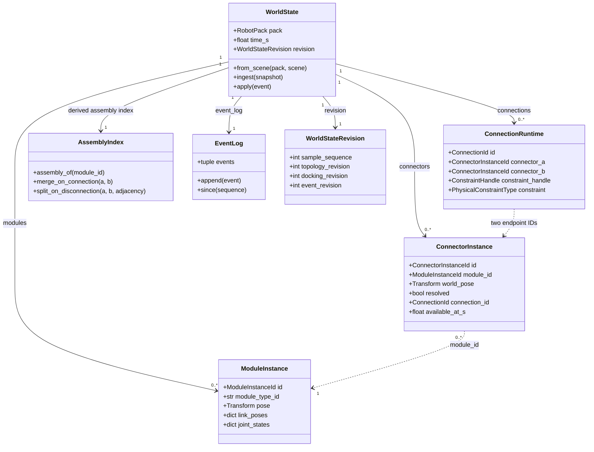
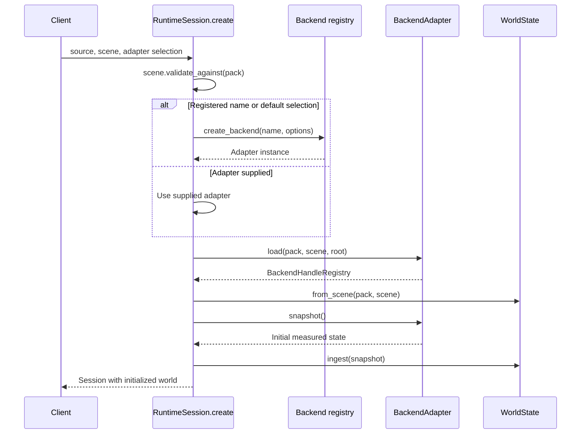
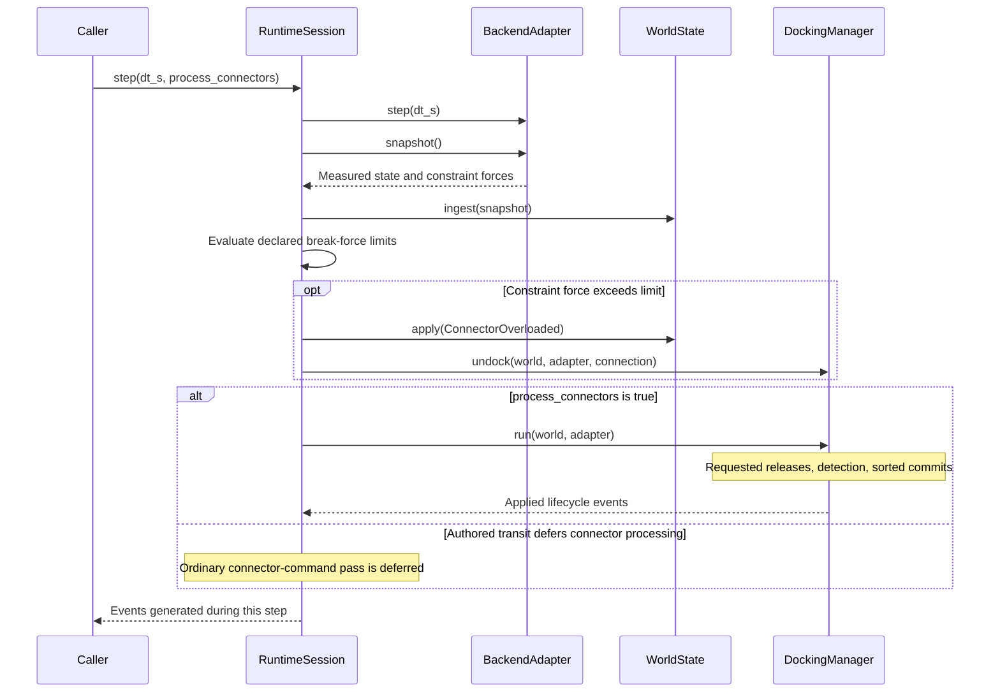

A RobotPack describes what kinds of modules and connectors exist. A runtime
session creates particular module instances, loads them into a backend, and
keeps ModSim's semantic state synchronized with measured mechanical state.
This is the boundary between a reusable description and one running experiment.

The central implementation is `RuntimeSession` in
`src/modsim_robotics/runtime/session.py`, working with `SceneSpec`, `WorldState`,
and the backend protocol. Read the [RobotPack pipeline](robot-pack-pipeline.md)
first if the distinction between a pack and a running scene is unfamiliar.

## Types become identified instances

`SceneSpec` in `core/scene.py` contains an ordered tuple of `ModulePlacement`
records: an instance ID, a module-type ID, and an initial `Transform`.
`SceneSpec.of()` accepts explicit placements; `grid()` creates a simple line of
instances for examples. `validate_against()` rejects empty scenes, duplicate
instance IDs, and module types absent from the pack. `module_links()` collects
the named root, joint, and connector links needed by adapters.

`WorldState.from_scene()` in `core/state.py` creates one `ModuleInstance` per
placement and one `ConnectorInstance` per declared connector. Connector IDs
combine the module instance and pack-local connector ID. The world starts with
no committed connections and an assembly of size one for every module.

The UML below describes held objects and ID associations verified in the
source. It is curated for the runtime model; it is not an inference that every
ID represents a nested Python object.

The world is canonical for the runtime's measured state and committed semantic
relationships. Its public collections are exposed as mappings, but their
entities remain mutable runtime objects; clients should use the session and
world operations rather than editing connection dictionaries or lifecycle
fields directly.

The mutable entity records live in `core/entities.py`. `ModuleInstance` holds
measured module/link/joint state, `ConnectorInstance` holds resolved interface
state and availability, and `ConnectionRuntime` links endpoint IDs to an
acknowledged constraint handle. Their roles differ from the frozen type models
in a RobotPack even when some field names look similar.

## Session creation connects the layers

`RuntimeSession.create()` accepts a `LoadedRobotPack` or in-memory `RobotPack`,
a scene, and either an adapter instance, registered backend name, or no adapter
selection. A loaded pack supplies its asset directory automatically; an
explicit `root` overrides it. Extra backend options are forwarded when a
factory constructs the adapter, rather than applied to an existing instance.

This core operation does not resolve a model-view recipe or create a GUI.
Headless tests, batch experiments, and custom control loops can step the
session and inspect `WorldState`, events, or metrics without a generated
graph. A consumer that needs a representation requests one separately.

Studio adds launch preparation outside this core contract. Its **Runtime**
workspace assembles a `RuntimeInspectorConfig`, checks simulation metadata and
the selected backend, demonstration, and view, and saves confirmed edits before
starting an embedded Inspector. `RuntimeInspectorRunner` then owns session
creation and scenario execution in a worker thread or native-viewer process.
The Inspector's view requirement does not become a requirement of
`RuntimeSession.create()`; see [Studio and Inspector](studio-and-inspector.md).

Backend loading can fail even after structural validation, for example because
an asset name is unresolved or an optional dependency is missing. No successful
session is returned in that branch. A caller that supplies or manages an
adapter must still account for its resource lifecycle; `create()` is not a
universal transaction manager for arbitrary adapter failures.

## Measurements and events update different state

`BackendStateSnapshot` in `core/snapshot.py` carries backend time, link poses
and twists, optional joint measurements, optional connector frames, and scalar
constraint forces. `WorldState.ingest()` updates measured state directly. It
uses the snapshot's actual time, which matters when an adapter advances in
whole solver steps.

Connector world poses prefer directly measured frames, such as MuJoCo sites.
Otherwise the world composes the parent-link pose with the authored local pose.
A missing parent-link pose leaves a connector unresolved. Docking and approach
axes are authored in the parent-link frame and rotated with that link;
connector point velocity includes the body's angular-velocity lever-arm term.
These details are necessary for meaningful acceptance checks on articulated or
rotating modules.

`WorldState.apply()` handles semantic lifecycle events. `DockCommitted` creates
a `ConnectionRuntime`, engages both endpoints, and merges their assembly
index entries. `UndockCommitted` removes that connection, frees its endpoints,
sets cooldown times, and recomputes the affected connected component.
`EventLog.append()` in `core/events.py` assigns sequence order to the immutable
event record.

The distinction is essential: the event log explains semantic connection
history, **not every measured pose or physics step**. Replaying connection
events alone does not reproduce a mechanical trajectory. Transient detection
states are also managed separately through ingestion and `mark_lifecycle()`.

## Step order is part of the architecture

`RuntimeSession.step()` owns the sequencing shown below. Controllers and
[scenarios](planning-and-scenarios.md) choose commands; they do not replace the
session's synchronization pipeline.

Overload handling runs even with `process_connectors=False`. That option is
used by authored transits that must reach a specific docking endpoint without
passive capture partway along their route. It still advances physics, ingests
measurements, and attempts overload releases through the ordinary guarded
undocking path. It is not a general pause or a way to disable all safety checks.
An overload can still release a connection and consume a queued release for
that connection, even though the ordinary connector pass is deferred.

`process_docking()` performs connector processing against the current world
without advancing backend time. `request_dock()` and `request_undock()` queue
intent; neither method itself moves modules or confirms a connection. The
[docking lifecycle](docking-lifecycle.md) explains the decisions and backend
acknowledgment inside that pass.

## Assemblies and views remain derived

`AssemblyIndex` in `core/assemblies.py` indexes connected components over module
instances and committed connections. Every module belongs to exactly one
assembly, including a disconnected singleton. Assembly IDs derive from
membership using the smallest module ID. A new connection may close a loop
without merging two components; removing an edge may leave a component
connected through another route.

The index updates alongside the commit event. `AssemblyMerged` and
`AssemblySplit` record the resulting membership change; they are not separate
instructions to rebuild a second canonical graph. Graph and lattice
[model views](model-views.md) are further immutable projections of the world.

`WorldStateRevision` separates sample, topology, docking, and event counters.
Ingestion advances sampling; committed connection changes affect topology;
lifecycle changes affect docking; appended events advance event revision.
Consumers can invalidate the projections they depend on without treating every
render as a new simulation state.

## Commands and shutdown have explicit limits

`set_joint_commands()` validates the complete batch against joint existence,
declared control modes, backend capabilities, finite values, and unit-bearing
limits before forwarding it through `SupportsJointCommands`. Actual actuator
submission belongs to the backend. The current MuJoCo implementation supports
`effort`; schema vocabulary for position or velocity is not an implementation
of those controllers.

Finally, `shutdown()` delegates resource cleanup to the adapter. It does not
emit an undock event for every connection or erase the retained semantic world.
That retained state is useful for final inspection, but callers must stop
stepping and issuing commands after cleanup. The
[Studio and Inspector architecture](studio-and-inspector.md) explains how GUI
clients arrange ownership around this same session contract. Use the
[Python API reference](../reference/python-api.mdx) for individual fields and
method signatures.
