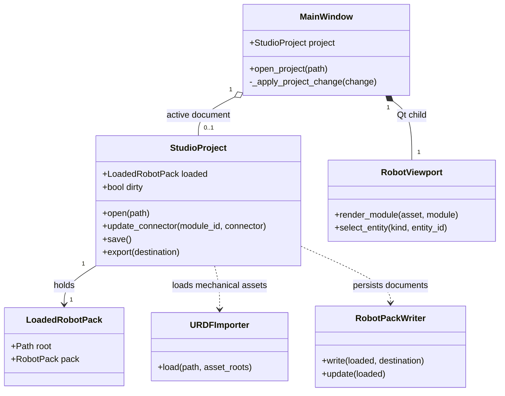
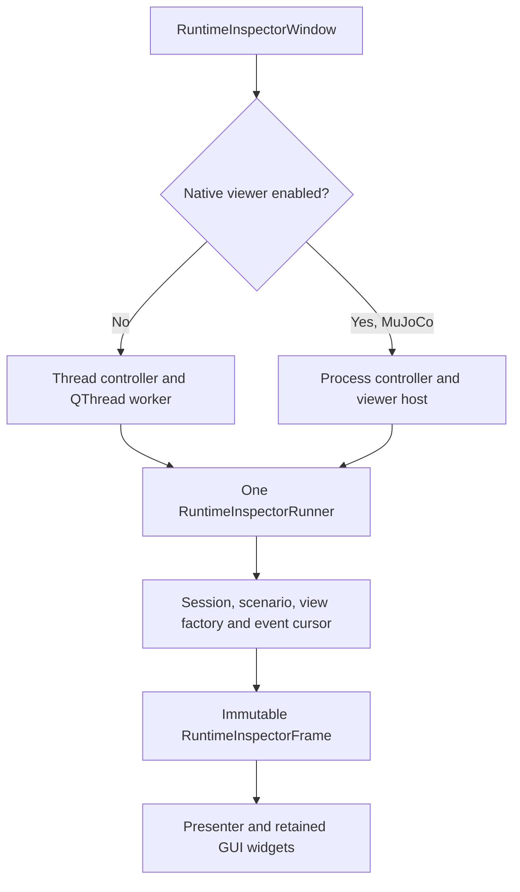
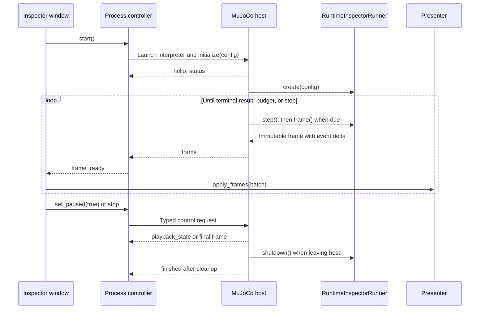

ModSim Studio contains two desktop applications with different ownership
boundaries. The **Robot Pack Builder** edits a saved robot description. The
**Runtime Inspector** observes one running demonstration and controls its
playback. Both consume core models; Qt, PyVista, PyQtGraph, and the simulator's
viewer remain outside the core package.

Start with the [architecture overview](index.md) for the complete system, or
the [codebase map](codebase-map.md) for a reading order. This page explains why
the two applications are separate, where editable state lives, and how live
simulation reaches a responsive GUI.

## Builder document ownership

`modsim_robotics_studio.app.main()` resolves a supplied pack selector, configures
session logging, and initializes the shared theme and application icon. It
shows `StartupSplash` and calls `play_intro()` before importing and constructing
`MainWindow`. The Qt event loop animates the supplied SVG logo for approximately
1.1 seconds before that heavier initialization. `present(window)` shows the
prepared main window after at least three seconds have elapsed since the splash
first appeared. Initialization time counts toward this minimum. The splash can
pause while GUI-thread imports or VTK construction run; its animation is a
branding sequence, independent of measured application progress. Closing the
splash cancels the handoff, and startup failure closes it immediately.
With no selector it passes
`initial_path=None`, leaving the Builder at its welcome screen without a
`StudioProject`. The standalone launcher and CLI support both this blank
authoring state and explicit pack names or paths. Launching the window does not
initialize the user's library or choose an implicit robot.

The blank Builder provides **Open Robot Pack** and **Create from URDF** while
Save and Export As remain disabled. It logs to
`<working-directory>/.modsim/logs/studio.log` unless `MODSIM_STUDIO_LOG` overrides
the path. Opening or importing a pack later in the session keeps that same log.

`MainWindow` owns widgets, selection, dialogs, and the current `StudioProject`.
`StudioProject` is a GUI-independent frozen dataclass in `project.py`. It holds
a `LoadedRobotPack`, imported URDF assets used for visualization, and a `dirty`
flag. Its update methods produce replacement projects after strict validation;
the widgets do not mutate fields on the frozen RobotPack models directly.

Opening a pack first uses `RobotPackLoader`, then imports every declared URDF
through `URDFImporter`. **Create from URDF** instead calls
`StudioProject.create_from_urdf()`, which delegates draft generation to
`DraftPackBuilder`. Successful import writes a new draft directory immediately,
then installs the resulting project in the window and enables Save and Export
As. Later semantic edits remain in memory until persisted. This preserves the
distinction between the mechanical asset and authored connector semantics
described in the [RobotPack pipeline](robot-pack-pipeline.md).

Document parsing and persistence run through `BusyDialog.run()` in a temporary
worker. A window-modal branded panel guards the active document while a nested
Qt event loop services painting and timers. Only GUI-independent importer and
`StudioProject` work enters that worker. Results return to `MainWindow` before
widgets, project selection, or VTK scenes change. The worker finishes before
the action returns; exceptions propagate to the existing user-error handler.
Preview construction remains on the GUI thread with its own loading stage.

Editors call methods such as `update_module_metadata()`, `update_connector()`,
`update_connector_type()`, and `update_model_view()`. These methods revalidate
the aggregate and check references relevant to the edit. For example, a module
root must exist in its imported URDF, and a connector must name an existing
connector type and imported link. Failed input leaves the previous project
available; the window displays a concise error while logging diagnostic detail.

**Apply** updates the in-memory document. **Save** delegates to
`RobotPackWriter.update()` and returns a clean project only after persistence
succeeds. **Export As** uses the writer's new-directory operation, then opens
the exported document as the current project. YAML Preview uses the same
writer's canonical document rendering and stays read-only. Saving and exporting
therefore share the core persistence contract rather than implementing a
second format in the UI.

## Authoring viewport and supporting modules

`RobotViewport` renders the selected module's imported geometry and diagnostic
layers. It retains VTK graphics objects after scene construction: selecting a
link or toggling a layer changes highlights or visibility without rereading
meshes. Connector edits replace overlays; they do not rebuild unchanged
mechanical geometry. **Fit** explicitly changes the camera. The viewport is an
authoring preview, so its ground grid and camera are presentation state.

The current preview shows one module at its URDF zero-joint configuration.
Picking selects links; connector placement uses numeric fields rather than a
3D transform gizmo. Editing dimensions or mechanical structure requires a URDF
change and reimport. The importer consumes expanded URDF, does not execute
Xacro or fetch remote assets, and leaves texture-image handling deferred.

| Source within `src/modsim_robotics_studio/` | Responsibility |
| --- | --- |
| `launcher.py`, `app.py`, `__main__.py` | Argument handling, application entry, exception logging, and process lifetime. |
| `project.py` | Validated document operations and persistence delegation, without Qt imports. |
| `main_window.py` | Project tree, property editors, validation actions, dialogs, and dirty-state handling. |
| `viewport.py` | PyVista/VTK geometry, layers, picking, and camera behavior. |
| `user_errors.py`, `session_logging.py` | Actionable input errors and session diagnostics outside saved pack contents. |
| `appearance.py`, `chrome.py`, `icons.py`, `visual_colors.py` | Production palettes, shared header/theme picker, branded toolbar glyphs, and stable category colors. |
| `_branding.py`, `_desktop.py`, `_loading.py`, `_splash_animation.py`, `assets/branding/` | Packaged assets and their provenance, desktop identity and icon registration, outlined logos and SVG animation, timed startup splash, document loading, and runtime loading panel. |
| `_window_sizing.py` | Completed-layout and font-aware sizing in logical pixels, parent/pointer monitor selection, desktop bounds, and local normal-geometry/dock-layout preferences. |

The Builder exposes **File**, **Validate**, and **View** menus. It currently
has no **Run** button or embedded Runtime Inspector. Simulation starts through
the runtime launcher, with its own configuration and execution lifetime.
The CLI dispatches to the Qt application in its current interpreter; the
separate child described below is specifically the native MuJoCo viewer host.

## Selecting a live execution owner

`runtime_app.main()` uses the same animated intro and three-second minimum
splash before presenting `RuntimeInspectorWindow`. The window's first
`showEvent` schedules the configured demonstration through a zero-delay Qt
timer, guarded against starting it again. Constructing a hidden window does
not start execution. The window
chooses its controller from `RuntimeInspectorConfig.viewer_enabled`:

After the branding splash hands off, the window keeps its runtime loading
artwork visible until its presenter accepts and
displays a valid frame. Status messages describe initialization without
inventing a completion percentage. Stop remains available. Terminal paths
stop the animation even if no frame arrives. Once a frame is presented, the
normal workspace tabs take over without an additional minimum display time;
no new loading state enters `WorldState` or
the runtime protocol.

These are alternative ownership paths. Semantic-only inspection, including
`--no-viewer`, uses `RuntimeInspectorThreadController` and
`RuntimeInspectorWorker`. The worker exclusively constructs and steps the
Qt-free `RuntimeInspectorRunner` in a `QThread`. The GUI receives frozen frame
values through queued signals. It never traverses the worker's live
`WorldState` or calls its adapter while physics advances.

With the native MuJoCo viewer enabled, `RuntimeInspectorProcessController`
uses `QProcess` to start
`modsim_robotics_backend_mujoco.runtime_inspector_process`. That child owns
the runner, scenario, session, factory, `MjModel`, and `MjData`. Its native
viewer renders those same model/data objects. The Qt parent owns the semantic
window and receives copies of state. On macOS the launcher selects `mjpython`
beside the active interpreter so the viewer can own the appropriate native
main-thread loop; other platforms use the active Python interpreter.

## Process protocol and playback

The child and parent communicate using strict, newline-delimited JSON records
defined in `modsim_robotics/runtime/inspection_protocol.py`. The current
prefix is `MODSIM_RUNTIME/3 `, with an 8 MiB limit per encoded record.
`RuntimeProtocolFramer` handles records split across reads and rejects malformed
or unterminated input. Stdout carries protocol records; diagnostics use stderr.

Pause is acknowledged by the execution owner at a step boundary. The window
shows a pending state until confirmation arrives. In the viewer path, Space
and the Inspector update the same pause request. Playback speed changes
wall-clock pacing through `runtime/pacing.py`; it does not change the physics
timestep, actuator limits, or event timestamps.

Interactive hosts stop advancing when the scenario reports `complete` or
`failed`, or its simulation-time budget ends. The last frame remains available.
The native viewer can hold its final state until closed. The lower-level
runner's `step()` remains callable for explicit physical hold experiments, so
terminal stopping is a host policy rather than a hidden restriction in the
session API.

## Lossless presentation and shutdown

`RuntimeInspectorRunner.frame()` builds a coherent supported model view,
metrics, scenario status, and events beginning at its cursor. It advances that
cursor only after constructing the frame. `RuntimeInspectorFrame` validates
that event sequence numbers cover the exact declared interval. Optional
SMORES or M-Blocks planning snapshots must match the view's time, sample
sequence, and topology revision; a frame cannot carry both planner payloads.

The GUI batches received frames for painting while
`RuntimeInspectorPresenter.apply_frames()` merges every event delta. It rejects
gaps or conflicting duplicates instead of silently losing history. Topology
node layout, selection, labels, and lattice camera state belong to the
presenter. `runtime_graph.py` and `runtime_lattice.py` retain graphical items;
`runtime_planning.py` and `runtime_mblocks_planning.py` render planner intent
separately from committed world edges. The [model-view page](model-views.md)
explains this immutable transport boundary in more detail.

Stop and close request cooperative interruption. The thread worker checks a
thread-safe event during stepping and pacing and shuts the backend down in
`finally`. The process controller sends `RuntimeStop`, then applies bounded
terminate/kill escalation if the child will not exit. Protocol errors, child
crashes, setup failures, presentation failures, and cleanup failures produce
explicit error state and logs. Completion, manual stop, failure, and exhausted
time remain distinct outcomes.

To extend Studio, put a new document operation in `StudioProject` before wiring
an editor, or add a new view renderer around immutable results. Put new
simulation behavior in a core scenario consumed by the runner. The current
Inspector supports topology and cubic-lattice views; broader builder support
needs an explicit renderer and transport decision. Continue with
[planning and scenarios](planning-and-scenarios.md),
[backend ownership](backends.md), or the [Python API](../reference/python-api.mdx).
