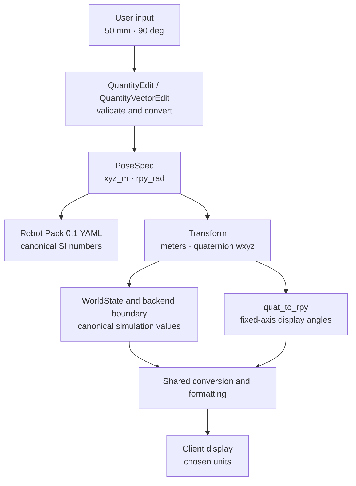

ModSim's canonical simulation state uses SI values and quaternion orientations.
People can author a connector in millimeters and degrees without changing that
contract. The units layer converts explicit inputs before they reach a model
and formats canonical values when a client displays them.

Unit choice, rotation representation, and coordinate frame are separate
decisions. Degrees and radians measure an angle; RPY and quaternions describe
an orientation; a parent-link or world frame determines what that orientation
is relative to. Changing one does not implicitly change the others.

## The conversion boundary

Robot Pack format 0.1 persists positions as `xyz_m` and authored orientations
as `rpy_rad`. Creating a runtime `Transform` converts that RPY description to
a unit quaternion. Composition, inversion, and connector geometry use those
quaternions rather than integrating Euler angles.



The conversion helpers return ordinary floats and tuples. Runtime stepping
does not carry unit strings or quantity wrapper objects. Backend adapters
continue receiving canonical quantities and performing any engine-specific
mapping at their own boundary.

| Quantity | Canonical unit | Supported conversion symbols |
| --- | --- | --- |
| Length | `m` | `m`, `cm`, `mm` |
| Angle | `rad` | `rad`, `deg`; `°` aliases `deg` |
| Linear velocity | `m/s` | `m/s`, `cm/s`, `mm/s` |
| Angular velocity | `rad/s` | `rad/s`, `deg/s`, `rpm` |
| Time | `s` | `s`, `ms` |
| Mass | `kg` | `kg`, `g` |
| Force | `N` | `N`, `mN`, `kN` |
| Torque | `N*m` | `N*m`, `N*mm` |
| Moment of inertia | `kg*m^2` | `kg*m^2`, `kg*mm^2` |
| Linear acceleration | `m/s^2` | `m/s^2`, `cm/s^2`, `mm/s^2` |
| Linear stiffness | `N/m` | `N/m`, `N/cm`, `N/mm` |
| Angular stiffness | `N*m/rad` | `N*m/rad`, `N*m/deg`, `N*mm/rad`, `N*mm/deg` |
| Linear damping | `N*s/m` | `N*s/m`, `N*s/cm`, `N*s/mm` |
| Angular damping | `N*m*s/rad` | `N*m*s/rad`, `N*m*s/deg`, `N*mm*s/rad`, `N*mm*s/deg` |
| Cyclic frequency | `Hz` | `Hz`, `kHz` |

The registry is closed and case-sensitive, with explicit aliases for selected
symbols. `QuantityKind` checks semantic compatibility: length cannot be
converted to an angle. Angular velocity remains distinct from cyclic frequency.
RPM converts to rad/s using `2π/60`. Torque and inertia have their own scales:
`1 N*mm = 0.001 N*m`, while `1 kg*mm^2 = 0.000001 kg*m^2`.
Denominator units invert their conversion: `1 N/mm = 1000 N/m` and
`1 N*m/deg = 180/π N*m/rad`. Changing angle presentation does not implicitly
change a stiffness's declared unit.

Axis vectors, quaternion components, friction coefficients, and integer lattice
cells are not lengths or angles. The converter never traverses arbitrary
metadata or model-view JSON to guess which numbers should change.

## Authoring and runtime rotation

RPY means fixed-axis roll about X, pitch about Y, and yaw about Z. ModSim keeps
the URDF convention:

```text
R = Rz(yaw) Ry(pitch) Rx(roll)
```

Runtime quaternions use scalar-first `(w, x, y, z)` ordering. Unit conversion
does not reorder quaternion components, change handedness, or move a pose to a
different frame. Pose translation and rotation remain relative to their
declared parent frame.

`quat_to_rpy()` extracts a readable triple in radians. Pitch is in
`[-π/2, π/2]`; roll and yaw are in `(-π, π]`. At gimbal lock, the extractor
sets roll to zero and represents the remaining rotation with yaw. Multiple
Euler triples can describe the same orientation. A displayed RPY triple
therefore does not replace the authoritative runtime quaternion unless a user
explicitly authors an edit.

Scalar angle conversion does not wrap turns. A continuous joint position of
450° retains its full 2.5π radians; replacing it with 90° would lose motion
history even though both can describe the same final orientation.

## Use the Python authoring API

These helpers require no Studio window or simulator. Their defaults remain
meters and radians; user preferences do not silently change a Python call's
meaning.

```python
import math

from modsim_robotics.core.transforms import Transform, quat_to_rpy
from modsim_robotics.robot_packs.schema import PoseSpec
from modsim_robotics.units import QuantityKind, format_quantity, from_si, parse_quantity

pose = PoseSpec.from_rpy(
    xyz=(50, 0, 25),
    rpy=(0, 0, 90),
    length_unit="mm",
    angle_unit="deg",
)
assert pose.xyz_m == (0.05, 0.0, 0.025)
assert math.isclose(pose.rpy_rad[2], math.pi / 2)

transform = Transform.from_pose_spec(pose)
# Transform.from_rpy(..., length_unit="mm", angle_unit="deg") is also available.
assert transform.translation == pose.xyz_m
assert math.isclose(from_si(quat_to_rpy(transform.rotation)[2], "deg"), 90.0)

distance_m = parse_quantity("2.5 cm", kind=QuantityKind.LENGTH, default_unit="mm")
assert distance_m == 0.025
assert format_quantity(distance_m, "mm") == "25 mm"
```

`to_si()` and `from_si()` convert explicit scalar magnitudes;
`to_si_vector()` and `from_si_vector()` convert three components without
changing their frame. `convert()` maps directly between compatible units.
`parse_quantity()` accepts a number, scientific notation, and an optional
supported suffix such as `50mm` or `90 deg`. A bare number uses the explicit
`default_unit` argument. It does not evaluate mathematical expressions or
infer units from magnitude. Unsupported or incompatible units, booleans,
non-finite values, and overflowing conversions raise `UnitError`.

The [conversion API](../reference/api/modsim_robotics/units/conversion/index.md)
documents the exact signatures and error conditions. The
[schema API](../reference/api/modsim_robotics/robot_packs/schema/index.md) and
[transform API](../reference/api/modsim_robotics/core/transforms/index.md)
describe the pose constructors and quaternion operations.

## Contextual quantity metadata

`quantity_for_field()` is a closed registry for declared physical fields. It
returns no conversion for an unknown field. Generic joint state and command
scalars require their mechanical type and control mode:

| Joint type | Position | Velocity | Effort |
| --- | --- | --- | --- |
| Revolute or continuous | Angle | Angular velocity | Torque |
| Prismatic | Length | Linear velocity | Force |

```python
import math

from modsim_robotics.units import joint_quantity_kind, joint_value_to_si

assert joint_quantity_kind("prismatic", "effort").value == "force"
torque_nm = joint_value_to_si(
    500, "N*mm", joint_type="revolute", control_mode="effort"
)
assert torque_nm == 0.5
speed_rad_s = joint_value_to_si(
    60, "rpm", joint_type="continuous", control_mode="velocity"
)
assert math.isclose(speed_rad_s, math.tau)
```

These helpers normalize an input for existing `JointCommand` and `JointLimits`
APIs. The backend still decides which command modes it implements. Selecting a
unit does not add an unsupported controller or physical constraint.

## Studio, runtime, and Inspector preferences

Choose **View → Display units** in Studio, or **Display units** in the standalone
Inspector. Both use one chooser for the fifteen quantity kinds above. Windows
using the same resolved ModSim data home share a preference manager.

Defaults are mm, degrees, seconds, kilograms, N, N*m, and kg*m². Linear and
angular velocity can follow length/angle preferences or use an explicit
override, including RPM. Linear acceleration can follow length or use an
explicit override. These derived choices remain **per second**, even when the
time display uses milliseconds. Stiffness, damping, torque, and frequency have
their own explicit choices.

| Surface | Unit-aware behavior |
| --- | --- |
| Module metadata | Mass is edited as a physical quantity. |
| Connector placement | Position XYZ and fixed-axis RPY accept preferred or explicitly suffixed units in creation and editing. |
| Connector rules | Discrete orientation lists, acceptance tolerances/speed, load limits, stiffness, hinge separation, cooldown, and break force map to their declared quantities. |
| Joint metadata | Position, velocity, and effort fields use joint-type-specific quantities. |
| Cubic-lattice recipe | Pitch, tolerances, world origin, and world RPY have typed controls; world orientation persists as a quaternion. |
| Runtime setup | Duration, timestep, initial height, gap, orientation, approach/retraction speeds, release time, and UI frequency convert before launch. |
| Inspector | Measured module world XYZ/RPY, times, typed event details, pose residuals, planning diagnostics, tooltips, and plot axes follow the profile. |

Lattice coordinates remain integer **cells**. Plot curve coordinates, hit tests,
selection state, and camera ranges remain canonical; only axis labels and text
convert. Preferences can therefore change during a run without repositioning
the graph or changing physical state. The external MuJoCo viewer continues using
its native presentation controls.

Scalar, optional, vector, and list editors retain canonical SI caches separately
from formatted text. A bare number uses the suffix displayed beside that input;
a compatible explicit suffix such as `5 cm`, `180 deg`, or `250 ms` overrides it.
Blank optional fields retain their unspecified/automatic meaning. List entries
can carry separate explicit suffixes, separated by commas.

Repeated unit switches preserve exact cached values without reparsing rounded
display text. Valid pending edits convert for display without being applied to
the pack. An unfinished or invalid scalar/list retains its old text and unit;
an invalid vector retains all three components atomically. Correct it before
switching that editor's unit again. Preferences alone never change the dirty
flag, saved YAML, runtime geometry, or physics.

The cubic-lattice editor preserves the original quaternion exactly until its
RPY is explicitly edited. **Edit raw builder configuration** exposes canonical
JSON when needed. Other builders keep their declared JSON structure and units;
the editor never guesses the meaning of arbitrary metadata.

## Local profile and terminal workflow

Preferences are local user data, separate from a Robot Pack:

```text
~/.modsim/
  config.toml    # pack-library configuration
  units.toml     # local display profile
```

A profile contains `schema_version = 1` and a `[units]` table. For example:

```toml
schema_version = 1

[units]
length = "mm"
angle = "deg"
time = "ms"
mass = "kg"
force = "N"
torque = "N*m"
inertia = "kg*m^2"
angular_velocity = "rpm"
linear_stiffness = "N/m"
angular_stiffness = "N*m/rad"
linear_damping = "N*s/m"
angular_damping = "N*m*s/rad"
frequency = "Hz"
```

The three derived fields are optional: `linear_velocity`, `angular_velocity`,
and `linear_acceleration`. Omission means follow the corresponding length/angle
choice. Other missing fields take their defaults. Existing two-field
length/angle profiles remain compatible.

`load_unit_preferences()` follows an explicit API `home`, then `MODSIM_PATH`,
legacy `MODSIM_HOME`, and `~/.modsim`. Reading absent preferences does not create
files. An explicit save writes atomically. Studio and Inspector `--home` select
this preference home as well as the installed library for named packs.

```bash
modsim-robotics units show --supported
modsim-robotics units set --length-unit mm --angle-unit deg --time-unit ms
modsim-robotics units set --angular-velocity-unit rpm
modsim-robotics units set --angular-velocity-unit auto
modsim-robotics units set --reset
```

Physical CLI options accept compatible explicit suffixes, for example
`--spacing "100 mm"`, `--orientation "90 deg"`, or `--dt "2 ms"`.
**Bare CLI numbers retain the documented SI meaning**, independently of the
saved display profile. Per-command `--length-unit`, `--angle-unit`, and
`--time-unit` choices affect human-readable output or the launched Inspector;
they do not reinterpret bare physical arguments. Physical result JSON remains
canonical; preference-command JSON describes unit choices rather than simulation
magnitudes. See [CLI tasks](../how-to/cli.md) for complete examples and aliases.

## Canonical telemetry and transport compatibility

Planning snapshots use `planning_time_s`, `flywheel_angular_velocity_rad_s`, and
`pivot_angle_rad`. Deprecated read-only convenience properties expose the old
`planning_ms`, `flywheel_rpm`, and `pivot_angle_deg` values for Python readers;
constructors and serialization use the canonical fields.

The current runtime process protocol is **version 4**. Its low-level decoder
can read a version-3 record and normalize only those declared legacy telemetry
fields before strict validation. This is a transport migration, not recursive
conversion of arbitrary JSON. A live Inspector and its worker/viewer child
should run the same installed ModSim version.

Typed event quantities are formatted using explicit field metadata. Raw JSON,
YAML preview, saved packs, and machine-readable exports keep canonical values.
Unstructured diagnostic messages retain their explicitly documented units;
the client does not rewrite strings by guessing which numbers denote physics.

## Source responsibilities

| Source | Responsibility |
| --- | --- |
| `modsim_robotics/units/definitions.py` | Quantity kinds, immutable scales, aliases, and supported choices. |
| `modsim_robotics/units/conversion.py` | Finite conversion, strict parsing, and formatting. |
| `modsim_robotics/units/fields.py` | Closed field metadata and contextual joint quantity resolution. |
| `modsim_robotics/units/preferences.py` | Validated display profile and derived units. |
| `modsim_robotics/unit_settings.py` | Side-effect-free reads and atomic local saves. |
| `modsim_robotics/core/transforms.py` | Quaternion math and fixed-axis RPY conversions. |
| `modsim_robotics/robot_packs/schema.py` | Canonical pack poses and the authoring constructor. |
| `modsim_robotics_studio/quantity_widgets.py` | SI-retaining scalar, optional, vector, and list controls. |
| `modsim_robotics_studio/unit_preferences.py` | Home-scoped manager and change notification. |
| `modsim_robotics_studio/display_units_dialog.py` | Shared Studio/Inspector profile chooser. |
| `modsim_robotics_studio/runtime_quantity.py` | Canonical runtime numeric controls and display-only plot axes. |
| `modsim_robotics_studio/main_window.py` | Quantity-aware authoring and typed lattice configuration. |
| `modsim_robotics/cli_options.py` | Compatible quantity input and unchanged bare-number defaults. |
| `modsim_robotics/runtime/inspection_protocol.py` | Canonical transport and declared legacy telemetry migration. |

## Implementation checklist

- [x] Fixed SI and quaternion runtime contract, with existing RPY persistence.
- [x] Shared quantity definitions, conversion, parsing, formatting, and field metadata.
- [x] Context-aware joint quantities and readable Python pose constructors.
- [x] Shared fifteen-quantity user profile with local atomic persistence.
- [x] Authoring controls for module, joint, connector, and built-in lattice data.
- [x] Runtime setup and integrated/standalone Inspector presentation.
- [x] CLI quantity suffixes, persistent profile commands, and temporary output choices.
- [x] Canonical planning telemetry with explicit transport migration.
- [x] Automated coverage for conversion, precision, drafts, persistence, and runtime invariants.

Robot Pack format 0.1, the URDF format, and mechanical asset scaling remain
unchanged. Displaying millimeters never scales geometry by 1000. Alternate-unit
YAML and arbitrary unit algebra are separate format/API proposals, not required
for this mapping layer. See the [Robot Pack pipeline](robot-pack-pipeline.md)
and [runtime model](runtime-model.mdx) for the unchanged canonical boundaries.
